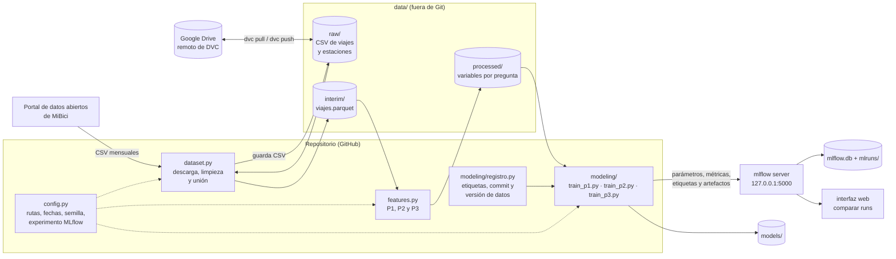
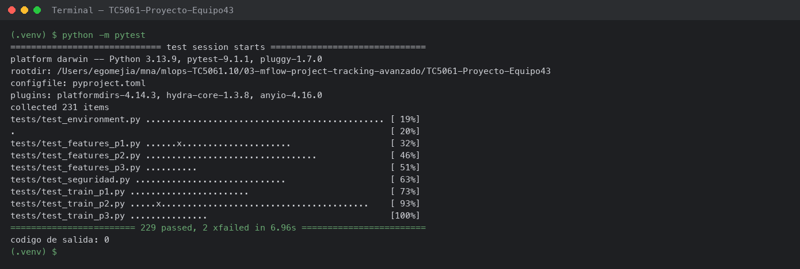
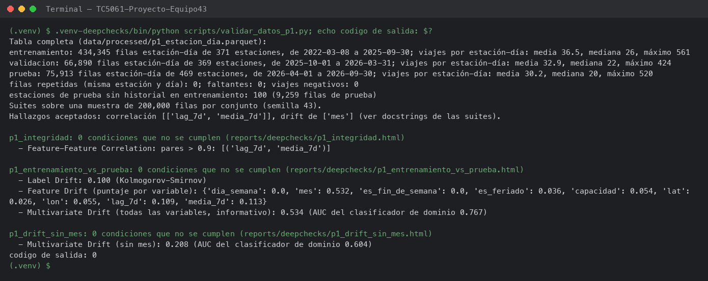
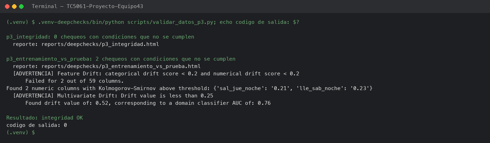
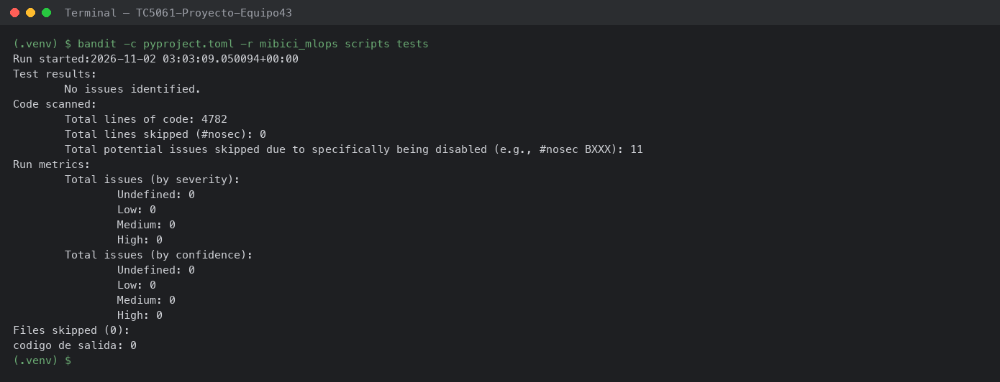
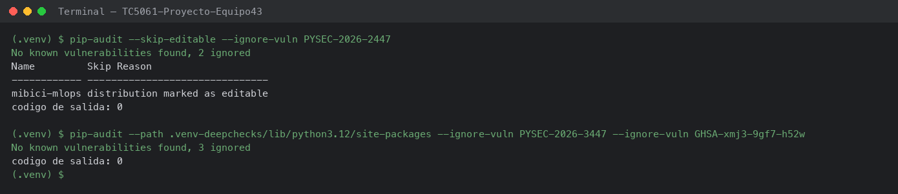

# TC5061-Proyecto-Equipo43 (MiBici MLOps)

<a target="_blank" href="https://cookiecutter-data-science.drivendata.org/">
    
</a>

Proyecto del equipo 43 (MLOps, TC5061.10). Usa los datos abiertos de MiBici, el sistema de
bicicletas públicas de Guadalajara, para responder tres preguntas de negocio con un pipeline
reproducible: ingesta, variables, entrenamiento y registro de experimentos en MLflow.

| # | Pregunta | Quién la usa | Tarea |
|---|---|---|---|
| P1 | ¿Cuántos viajes iniciarán en cada estación el día siguiente? | Operación: repartir bicicletas y personal por zona y día | Regresión |
| P2 | ¿Una estación estará en riesgo de quedarse sin bicicletas o sin anclajes? | Rebalanceo: a qué estaciones ir y si llevar o retirar bicicletas | Clasificación (3 clases) |
| P3 | ¿Qué grupos de estaciones comparten patrones de uso y dónde están? | Planeación urbana: dónde y de qué tipo abrir estaciones | Clustering |

El planteamiento completo está en el ML Canvas
([references/MLCanvas_MiBici.pdf](references/MLCanvas_MiBici.pdf)).

## Arquitectura



- **Datos:** los CSV crudos se versionan con DVC en el Drive del equipo; `dataset.py` también
  puede descargarlos del portal. Nada de `data/`, `models/`, `mlflow.db` ni `mlruns/` se sube a Git.
- **Configuración única:** `config.py` define las rutas, el periodo (`FECHA_INICIO`, `FECHA_FIN`),
  la partición temporal, la semilla (`SEMILLA`) y el experimento de MLflow (`mibici-equipo43`).
- **Experimentos:** cada `train_*.py` registra sus runs en el mismo experimento con la etiqueta
  `question` (P1, P2 o P3), el commit de Git y la versión de los datos. Las corridas se lanzan
  con `mlflow run` (ver [MLflow Project](#mlflow-project)).

## Datos

Los datos crudos son los [datos abiertos de MiBici](https://mibici.net/es/datos-abiertos/) (viajes mensuales 2014-12 a 2026-09 y catálogo de estaciones). No se suben a GitHub: se versionan con DVC en el Google Drive del equipo. Si no tienes acceso a ese Drive, puedes descargarlos directamente de la página oficial.

Detalles de las fuentes, cómo obtener los datos y problemas conocidos en [references/fuentes_datos.md](references/fuentes_datos.md).

Las decisiones técnicas y de análisis del proyecto (por ejemplo, por qué los datos procesados se guardan en Parquet) están en [references/decisiones.md](references/decisiones.md).

## Cómo empezar

Requiere Python 3.13. Para bajar los datos con DVC hace falta acceso a la carpeta de Google
Drive del equipo: pídele a un integrante que comparta la carpeta con tu cuenta de Google y que te
agregue como *test user* de la app OAuth en Google Cloud; sin esto, `dvc pull` muestra "access
blocked". Sin ese acceso, ver la nota debajo del bloque de comandos.

```powershell
git clone https://github.com/robertonali/TC5061-Proyecto-Equipo43.git
cd TC5061-Proyecto-Equipo43
python -m venv .venv
.venv\Scripts\activate
python -m pip install -r requirements.txt
dvc remote modify --local drive gdrive_client_secret <secreto>
dvc pull
python -m mibici_mlops.dataset
```

- **`pyOpenSSL`**: `requirements.txt` fija `pyopenssl` y `pydrive2` para que DVC no falle con
  `module 'lib' has no attribute 'GEN_EMAIL'` y para que `pip check` pase (ver el comentario en
  `requirements.txt`). Ya no hace falta instalarlo aparte.
- **`<secreto>`**: el secreto del cliente OAuth de Google. Se comparte por un canal privado y se
  guarda en `.dvc/config.local`, que no se sube a Git. **Nunca lo pongas en `.dvc/config`.**
- **`dvc pull`**: la primera vez abre el navegador para autorizar tu cuenta de Google.
- **`python -m mibici_mlops.dataset`**: une y limpia los 142 CSV de `data/raw/viajes/` en
  `data/interim/viajes.parquet` (~39 millones de viajes; tarda entre 5 y 10 minutos). Qué
  corrige y por qué está en [references/fuentes_datos.md](references/fuentes_datos.md).

**Sin acceso al Google Drive**, omite las líneas de `dvc remote` y `dvc pull`:
`python -m mibici_mlops.dataset` descarga de la página de MiBici los CSV que falten en
`data/raw/` (hasta `FECHA_FIN` de `config.py`, ~2.9 GB) y abril y mayo de 2023 de Internet
Archive. Si ya hiciste `dvc pull` no descarga nada; para no intentarlo, usa `--sin-descargar`.
Los archivos descargados pueden no ser idénticos a la versión de DVC si MiBici los actualiza.

### Verificar que todo quedó bien

| Después de | Revisa | Resultado esperado |
|---|---|---|
| `dvc pull` | `dvc status` | `Data and pipelines are up to date.` |
| `python -m mibici_mlops.dataset` | Las últimas líneas del log | `datos_abiertos_2026_09.csv: 758 filas duplicadas eliminadas` y `39,078,082 viajes guardados` |
| `python -m mibici_mlops.dataset` con datos descargados de la página (sin `dvc pull`) | Las últimas líneas del log | `39,078,226 viajes guardados` al 2026-10-18: MiBici corrigió algunos CSV después de que se registró la versión de DVC |
| Todo lo anterior | Correr `notebooks/1.0-rc-periodo-de-datos.ipynb` con el intérprete de `.venv` | La sección 6 muestra 0 filas con `viaje_id` repetido |

Si un resultado no coincide, avisa al equipo con el mensaje de error antes de seguir.

Al clonar, `data/` solo trae `.gitignore` y `raw.dvc`: `dvc pull` crea `data/raw/`,
`dataset.py` crea `data/interim/` y `features.py` crea `data/processed/` (ver la sección de P2).

### Versionar cambios en los datos

```powershell
dvc add data/raw
git add data/raw.dvc
git commit -m "Actualizar datos"
dvc push        # si falla con WinError 10054: dvc push -j 2
git push
```

## MLflow: servidor de tracking local

Los scripts `train_*.py` mandan sus runs a un servidor de MLflow que corre en tu computadora. El
servidor guarda parámetros, métricas, etiquetas y modelos registrados en `mlflow.db` (SQLite), el
almacenamiento con base de datos que requiere el Model Registry, y los artefactos en `mlruns/`.
Ninguno de los dos se sube a Git: cada integrante tiene su propio historial.

Antes de entrenar, levanta el servidor en una terminal aparte, desde la raíz del proyecto y con el
entorno virtual activado, y déjalo corriendo:

```powershell
mlflow server --backend-store-uri sqlite:///mlflow.db --artifacts-destination mlruns --port 5000 --workers 1
```

Los runs se ven en http://127.0.0.1:5000. Para detener el servidor, `Ctrl+C` en esa terminal.

- Los scripts se conectan a `http://127.0.0.1:5000` (`MLFLOW_TRACKING_URI` en `config.py`). Para
  usar otro servidor, define `MLFLOW_TRACKING_URI` en un archivo `.env` en la raíz del proyecto.
- `--workers 1` levanta un solo proceso. Con los 4 que usa por defecto, en Windows algunos fallan
  con `WinError 10022` porque no pueden compartir el puerto.
- Si el servidor no está corriendo, `train_p1` y `train_p2` fallan de inmediato con un mensaje
  que indica el comando para levantarlo.

## MLflow Project

`MLproject`, en la raíz, declara el entorno (`python_env.yaml`: Python 3.13 con las versiones
fijas de `requirements.txt`) y tres puntos de entrada. Las rutas, fechas, semillas e
hiperparámetros por defecto salen de `config.py`; con `-P` solo se pasa lo que cambia.

| Punto de entrada | Qué corre | Parámetros |
|---|---|---|
| `ingest` | `dataset.py`: descarga los CSV que falten, los une en `data/interim/viajes.parquet` y escribe el manifiesto de los datos (`data/interim/manifiesto.json`) | `descarga`: `descargar` (por defecto) o `sin-descargar` |
| `features` | `features.py`: variables y etiqueta de una pregunta en `data/processed/` | `question`: `p1`, `p2` o `p3` |
| `train` | `modeling/train.py`, que llama al entrenamiento de la pregunta | `question`, `model` y los hiperparámetros del modelo (`-P nombre=valor`) |
| `register` | `modeling/registrar_<question>.py`: registra el modelo elegido en el Model Registry con los aliases `champion` y `challenger` y comprueba que se carga por nombre y alias | `question`; opcionales `-P champion=<run_id>` y `-P challenger=<run_id>` |

Desde un clon limpio, sigue [Cómo empezar](#cómo-empezar) hasta instalar `requirements.txt` (y
`dvc pull` si tienes acceso al Drive), levanta el
[servidor de MLflow](#mlflow-servidor-de-tracking-local) y, en otra terminal con el `.venv`
activado y desde la raíz del proyecto:

```powershell
$env:MLFLOW_TRACKING_URI = "http://127.0.0.1:5000"
mlflow run . -e ingest --env-manager local --experiment-name mibici-equipo43
```

Después siguen los comandos de cada pregunta (ver
[P1](#p1-demanda-de-viajes-por-estación-y-día),
[P2](#p2-riesgo-de-que-una-estación-se-vacíe-o-se-llene) y
[P3](#p3-grupos-de-estaciones-con-patrones-de-uso-parecidos)). Cada `mlflow run`
crea un run en el experimento `mibici-equipo43` e imprime su id al terminar
(`=== Run (ID '...') succeeded ===`).

- **`MLFLOW_TRACKING_URI`:** `mlflow run` crea el run antes de llamar al script. Sin la variable,
  MLflow lo escribe directo en `mlflow.db`, sin pasar por el servidor.
- **`--experiment-name mibici-equipo43`:** sin él, el run queda en el experimento `Default` y el
  script falla con un mensaje que lo indica.
- **`--env-manager local`:** usa el `.venv` activado. El entorno está declarado en
  `python_env.yaml`, pero con `virtualenv` o `uv` MLflow instala `requirements.txt` desde una
  carpeta temporal con enlaces al proyecto. En Windows, sin permisos de administrador, copia el
  proyecto completo (con los 2.9 GB de `data/raw`), y `-e .` deja el paquete apuntando a esa
  carpeta, que se borra al terminar (decisión 10 de P2).
- **Hiperparámetros:** se pasan con `-P` aunque no estén declarados en `MLproject`; MLflow los
  agrega al comando como `--nombre valor`, y los que no se pasan toman su valor de `config.py`.
  Así `MLproject` no repite los valores por defecto.
- **Opcional:** `$env:LOGNAME = "equipo43"` antes de `mlflow run` para que MLflow no guarde tu
  usuario de Windows en el campo interno de usuario de cada run.

### Reproducción de la entrega 2

El 2026-10-25 se corrió la entrega completa desde un clon limpio, con un servidor de tracking
nuevo y solo los comandos de este README: `ingest` (142 CSV descargados de los datos abiertos),
`features` de las tres preguntas, todos los `train` de P1, P2 y P3 y `register` de las tres. El
resultado son 44 runs en `mibici-equipo43`, todos con `cambios_sin_commit = false` (P1 y P2 con
el commit `045d186`; P3 y los registros con `3ba087d`), y los tres modelos registrados con
`champion` y `challenger`. Las cifras coinciden con las tablas de resultados de cada pregunta.

## Model Registry

El modelo elegido de cada pregunta se registra en el Model Registry del servidor, con nombre
`mibici-equipo43-<pregunta>-<tema>`. El ciclo de vida se gestiona con **aliases**:

| Alias | Significado |
|---|---|
| `champion` | La versión en producción: la que cargan las siguientes etapas del proyecto |
| `challenger` | La siguiente mejor, lista para reemplazar a `champion` |

**Por qué aliases y no etapas:** las etapas (`Staging`, `Production`) están obsoletas desde
MLflow 2.9. Un alias es un nombre que apunta a una versión: promover un modelo, o volver al
anterior si falla, es mover el alias, sin crear versiones ni cambiar el código que carga el
modelo. Cada versión guarda su linaje como etiquetas: experimento, run de origen, commit y versión
de los datos.

Con `MLFLOW_TRACKING_URI` apuntando al servidor:

```python
import mlflow

modelo = mlflow.pyfunc.load_model("models:/mibici-equipo43-p2-riesgo@champion")
```

| Pregunta | Modelo registrado | `champion` | `challenger` |
|---|---|---|---|
| P1 | `mibici-equipo43-p1-demanda` | `HistGradientBoostingRegressor` con pérdida de Poisson y 63 hojas | `RandomForestRegressor` |
| P2 | `mibici-equipo43-p2-riesgo` | Versión 1: `HistGradientBoostingClassifier` con pesos de clase | Versión 2: regresión logística |
| P3 | `mibici-equipo43-p3-clusters` | KMeans con 3 grupos sobre el perfil de uso | `GaussianMixture` con 2 componentes |

Cada pregunta se registra con `mlflow run . -e register -P question=<p1|p2|p3>` (ver la sección
de cada una).

## Despliegue: recuperar el modelo del Model Registry

La API sirve dos modelos, el `champion` de cada pregunta:

| Pregunta | Modelo en el registry | Constante en `config.py` |
|---|---|---|
| P1: demanda por estación y día (regresión) | `models:/mibici-equipo43-p1-demanda@champion` | `SERVICIO_MODELO_URI` |
| P3: grupo de una estación (clustering) | `models:/mibici-equipo43-p3-clusters@champion` | `SERVICIO_P3_MODELO_URI` |

Cada uno se recupera del registry por **nombre y alias**, nunca por la ruta de un run: promover
otra versión es mover el alias `champion` y volver a exportar, sin tocar el código.

**Basta con exportar uno de los dos.** La API sirve los modelos que encuentre en
`models/servicio/` y los endpoints del que falta responden `503` con el comando para exportarlo.
Para servir solo P3, exporta solo P3.

**Opción elegida: empaquetar en la imagen el modelo descargado del registry.** Antes de construir
la imagen, con el [servidor de MLflow](#mlflow-servidor-de-tracking-local) corriendo y el modelo
registrado (`mlflow run . -e register -P question=p3`, y `-P question=p1` si también se sirve P1):

```powershell
python -m mibici_mlops.api.modelo exportar --pregunta p3   # champion de P3 en models/servicio/p3/
python -m mibici_mlops.api.modelo probar --pregunta p3     # asigna grupo a 3 estaciones reales
python -m mibici_mlops.api.modelo exportar --pregunta p1   # opcional: champion de P1 en models/servicio/p1/
python -m mibici_mlops.api.modelo probar --pregunta p1     # lo carga como la API y predice 3 filas reales
```

Sin `--pregunta`, los comandos usan P1.

`exportar` resuelve a qué versión apunta el alias y descarga esa versión fija, junto con
`version.json` (nombre, alias, versión y run de origen) para que la API diga qué versión sirve.
`models/` está en `.gitignore`: la copia no se versiona, se regenera con `exportar`. Con `--uri`
se exporta otra versión, por alias o por número de versión:

```powershell
python -m mibici_mlops.api.modelo exportar --uri models:/mibici-equipo43-p1-demanda@challenger
python -m mibici_mlops.api.modelo exportar --uri models:/mibici-equipo43-p1-demanda/2
python -m mibici_mlops.api.modelo exportar --pregunta p3 --uri models:/mibici-equipo43-p3-clusters@challenger
```

Por número, `version.json` (y `/modelo`) registra `"alias": null`: la versión quedó fija a mano y
no la siguió ningún alias.

**Por qué esta opción y no leer el registry desde el contenedor:**

- **Funciona igual en cualquier máquina:** el contenedor no necesita el servidor de MLflow (que
  corre en la computadora de un integrante, con `mlflow.db` local) ni acceso a red para arrancar.
- **Reproducible:** la imagen lleva una versión fija del modelo. Si alguien mueve el alias, una
  imagen ya construida no cambia de modelo sin avisar; para cambiarlo se reconstruye la imagen.

**Alternativa soportada (registry en vivo):** si se define `MODELO_URI` (P1) o `MODELO_URI_P3`
(P3), la API ignora la copia empaquetada de ese modelo y carga del registry al arrancar:

```powershell
podman run -e MLFLOW_TRACKING_URI=http://host.containers.internal:5000 `
  -e MODELO_URI=models:/mibici-equipo43-p1-demanda@champion `
  -e MODELO_URI_P3=models:/mibici-equipo43-p3-clusters@champion ...
```

La lógica de carga está en [mibici_mlops/api/modelo.py](mibici_mlops/api/modelo.py).

### La API

[mibici_mlops/api/app.py](mibici_mlops/api/app.py) (FastAPI) carga el modelo una vez al arrancar
y expone:

| Endpoint | Qué hace |
|---|---|
| `GET /salud` | El servicio está arriba y qué versión tiene cargada de cada modelo (`version_modelo` y `version_modelo_p3`) |
| `GET /modelo` | Nombre, alias, versión y run de origen del modelo de P1 |
| `POST /prediccion` | P1: viajes esperados para una o varias estaciones-día |
| `GET /clusters/modelo` | Nombre, alias, versión y run de origen del modelo de P3 |
| `POST /clusters` | P3: grupo de una o varias estaciones a partir de su perfil de uso |

Los esquemas de entrada y salida están en [mibici_mlops/api/esquemas.py](mibici_mlops/api/esquemas.py)
(Pydantic). Cada fila trae las 9 variables del modelo (`COLUMNAS_P1`) y, opcionalmente,
`estacion_id`, que el modelo no usa y la respuesta devuelve para identificar cada predicción. Se
rechaza con `422` una fila con columnas de más o de menos, o fuera de rango: `dia_semana` de 0
(lunes) a 6, `mes` de 1 a 12, banderas en 0 o 1, `es_fin_de_semana` coherente con `dia_semana`,
`capacidad` positiva, ubicación dentro de Guadalajara y viajes de la última semana no negativos.
Las predicciones negativas se recortan a 0 (es un conteo de viajes).

Para `POST /clusters`, cada fila es el **perfil de uso** de una estación (`COLUMNAS_P3` en
`features.py`, la misma tabla `data/processed/p3_perfiles.parquet` con la que se entrenó): 56
fracciones, 28 de salidas (`sal_<día>_<franja>`) y 28 de llegadas (`lle_<día>_<franja>`), una por
día de la semana (`lun` a `dom`) y franja del día (`madrugada`, `manana`, `tarde`, `noche`),
más `estacion_id` opcional, que se devuelve tal cual. Se rechaza con `422` una fila con
columnas de más o de menos, con una fracción fuera de 0 a 1, con `NaN` o `Infinity`, o cuyo
bloque de salidas o de llegadas no sume 1 (con una tolerancia de 0.001, para perfiles redondeados
a 4 decimales). Los números de grupo (`cluster`) son los del modelo servido: no se conservan entre
versiones, así que hay que leerlos junto con `modelo.version`.

Para levantarla sin contenedor, después de `exportar`:

```powershell
uvicorn mibici_mlops.api.app:app --port 8000
```

La documentación interactiva queda en http://127.0.0.1:8000/docs.

Pruebas (`python -m pytest tests/test_api.py tests/test_api_p3.py tests/test_api_modelo_real.py`):

- `tests/test_api.py` usa un modelo falso y no necesita el servidor de MLflow: respuestas, recorte
  de negativos, filas inválidas (incluidos `NaN` e `Infinity`, que el JSON de FastAPI admite y se
  rechazan con `422`) y los formatos de URI del registry.
- `tests/test_api_p3.py` hace lo mismo para `POST /clusters`: orden de las 56 columnas, perfiles
  que no suman 1, fracciones fuera de rango, columnas de más o de menos y valores no finitos.
- `tests/test_api_modelo_real.py` levanta la API con los modelos exportados y compara sus
  respuestas con las de cada modelo cargado directamente en 400 filas reales (predicciones de P1
  y grupos de P3). Las de cada pregunta se saltan si falta su modelo exportado o sus datos.

### Contenedor

El [Containerfile](Containerfile) (estándar OCI; sirve igual con Podman y con Docker) parte de
`python:3.13.9-slim`, la versión de Python con la que se guardaron los modelos, instala solo
[requirements-api.txt](requirements-api.txt) (sin DVC, deepchecks ni notebooks) y copia el paquete
y la carpeta `models/servicio/` con los modelos exportados (P3, P1 o los dos). Una sola imagen
sirve las preguntas que se hayan exportado. Corre como un usuario sin privilegios y tiene un `HEALTHCHECK` contra
`/salud`. [.dockerignore](.dockerignore), que leen los dos motores, deja fuera todo lo demás
(datos, `.venv`, `mlruns/`, `mlflow.db`, `.env`).

**1. Exportar el modelo** (con el servidor de MLflow corriendo y el modelo registrado). Con
exportar P3 basta; P1 es opcional. Sin ningún modelo exportado, `docker build` falla porque no
existe `models/servicio/`:

```powershell
python -m mibici_mlops.api.modelo exportar --pregunta p3
python -m mibici_mlops.api.modelo exportar --pregunta p1   # opcional
```

**2. Construir la imagen:**

```powershell
podman build -t mibici-api -f Containerfile .
# o: docker build -t mibici-api -f Containerfile .
```

**3. Levantar el contenedor:**

```powershell
podman run --rm -d --name mibici-api -p 8000:8000 mibici-api
# o: docker run --rm -d --name mibici-api -p 8000:8000 mibici-api
```

Al arrancar, MLflow avisa que `psutil` y `pytest` no están instalados: aparecen en el
`requirements.txt` que infirió al guardar el modelo, pero el modelo no los usa para predecir, así
que no se agregan a la imagen.

**4. Consumir la API.** P1, demanda de una estación-día:

```powershell
curl.exe http://127.0.0.1:8000/modelo
curl.exe -X POST http://127.0.0.1:8000/prediccion -H "Content-Type: application/json" `
  -d '{\"filas\": [{\"estacion_id\": 512, \"dia_semana\": 3, \"mes\": 8, \"es_fin_de_semana\": 0, \"es_feriado\": 0, \"capacidad\": 15, \"lat\": 20.69256, \"lon\": -103.36436, \"lag_7d\": 4, \"media_7d\": 4.0}]}'
```

Respuesta:

```json
{
  "modelo": {
    "nombre": "mibici-equipo43-p1-demanda",
    "alias": "champion",
    "version": "1",
    "run_id": "54b6e4b6fc0a49129690261e56d5f1dc",
    "origen": "imagen"
  },
  "predicciones": [{"estacion_id": 512, "viajes": 6.46}]
}
```

(La versión y el run dependen del registry del que se exportó.) Una fila inválida, por ejemplo
con `"dia_semana": 9`, regresa `422` con el campo que falló.

P3, grupo de una estación a partir de su perfil de uso. Las 56 fracciones se mandan desde un
archivo: [references/ejemplo_p3_peticion.json](references/ejemplo_p3_peticion.json) es el perfil
de validación de la estación 244 (redondeado a 4 decimales):

```powershell
curl.exe -X POST http://127.0.0.1:8000/clusters -H "Content-Type: application/json" `
  --data-binary "@references/ejemplo_p3_peticion.json"
```

Respuesta (con el champion exportado de este registry, versión 1, que agrupa las estaciones en 3
grupos):

```json
{
  "modelo": {
    "nombre": "mibici-equipo43-p3-clusters",
    "alias": "champion",
    "version": "1",
    "run_id": "98d5e87a6b474312b569bd1f3e2ca735",
    "origen": "imagen"
  },
  "predicciones": [{"estacion_id": 244, "cluster": 1}]
}
```

(El grupo y la versión dependen del registry del que se exportó.) Un perfil cuyas salidas no
sumen 1 regresa `422` con el mensaje de qué bloque falló. Para detener el contenedor:
`podman stop mibici-api` (o `docker stop`).

Para usar el registry en vivo en lugar del modelo empaquetado, se agrega
`-e MLFLOW_TRACKING_URI=... -e MODELO_URI=models:/mibici-equipo43-p1-demanda@champion
-e MODELO_URI_P3=models:/mibici-equipo43-p3-clusters@champion` al `run`. El
host se llama `host.containers.internal` con Podman y `host.docker.internal` con Docker, y el
servidor de MLflow debe escuchar en `0.0.0.0` (no solo en `127.0.0.1`) para que el contenedor lo
alcance.

### Estrategia de despliegue: API en línea, usada por lotes

P1 se predice una vez al día, al cierre (23:59), para el día siguiente: por naturaleza es
inferencia **por lotes** (las 468 estaciones activas de una vez). Aun así se despliega como una **API
REST** que predice en el momento, y el proceso diario la usa mandando todas las estaciones en una
sola petición (`POST /prediccion` acepta hasta 5,000 filas):

- **Un solo camino para los dos usos:** el lote diario y las consultas sueltas (una estación, otro
  día, un escenario con feriado) usan el mismo modelo, la misma validación y la misma respuesta.
- **El costo de predecir es mínimo:** una tabla de cientos de filas se predice en milisegundos, así
  que no hace falta infraestructura de lotes (colas, almacenamiento de resultados).
- **Validación en la frontera:** Pydantic rechaza las filas mal formadas antes de llegar al modelo,
  y la respuesta dice qué versión del registry predijo, para rastrear cada predicción.
- **Si el volumen creciera** (p. ej. predicciones por hora para todo el año), el mismo
  `cargar_modelo()` puede correr como un job por lotes que lea y escriba parquet, sin pasar por HTTP.

P3 (grupos de estaciones) se sirve en la misma imagen, pero su uso es distinto: el perfil de una
estación se calcula con meses de viajes y cambia poco, así que no se consulta en tiempo real. El
caso de uso es **por lotes y bajo demanda**: planeación urbana recalcula los perfiles cuando hay
datos nuevos o evalúa una estación candidata, y manda todos los perfiles juntos a `POST /clusters`
(hasta 5,000 por petición). Se despliega como API, y no como un job aparte, por las mismas razones
que P1: un solo camino con la misma validación, y la respuesta dice qué versión del registry asignó
cada grupo. Eso importa más aquí que en P1, porque los números de grupo no se conservan entre
versiones del modelo: una asignación solo se interpreta junto con la versión que la produjo.

## P1: demanda de viajes por estación y día

**Pregunta:** ¿cuántos viajes iniciarán en cada estación durante el día siguiente? La usa
operación para repartir bicicletas y personal por zona y por día.

Las decisiones y su justificación están en
[references/decisiones_p1.md](references/decisiones_p1.md).

| Aspecto | Decisión |
|---|---|
| Tarea | Regresión: viajes que inician en la estación durante el día |
| Granularidad | Una fila por estación y día; los días sin viajes cuentan como 0 |
| Horizonte | Cada día a las 23:59 se predice el día siguiente |
| Variables | Historial que termina el día anterior (`lag_7d`, `media_7d`), calendario y datos de la estación |
| Modelos | Baseline: mismo día de la semana pasada (`lag_7d`). Candidatos: `Ridge`, `RandomForestRegressor` y `HistGradientBoostingRegressor` |
| Métricas | MAE y RMSE en viajes por estación-día (validación y prueba). El modelo se elige con el MAE de validación |
| Modelo en producción | `HistGradientBoostingRegressor` con pérdida de Poisson: `models:/mibici-equipo43-p1-demanda@champion` |

### Cómo correrlo

Con el [servidor de MLflow](#mlflow-servidor-de-tracking-local) corriendo, después de la ingesta
(ver [MLflow Project](#mlflow-project)) y con todo en commit:

```powershell
# Variables por estación y día
mlflow run . -e features --env-manager local --experiment-name mibici-equipo43 -P question=p1
# Baseline
mlflow run . -e train --env-manager local --experiment-name mibici-equipo43 -P question=p1 -P model=baseline
# Candidatos
mlflow run . -e train --env-manager local --experiment-name mibici-equipo43 -P question=p1 -P model=ridge
mlflow run . -e train --env-manager local --experiment-name mibici-equipo43 -P question=p1 -P model=rf
mlflow run . -e train --env-manager local --experiment-name mibici-equipo43 -P question=p1 -P model=hgb
# Búsqueda de hiperparámetros de hgb (nested runs) y su mejor combinación
mlflow run . -e train --env-manager local --experiment-name mibici-equipo43 -P question=p1 -P model=busqueda-hgb
mlflow run . -e train --env-manager local --experiment-name mibici-equipo43 -P question=p1 -P model=hgb -P max_leaf_nodes=127
# Model Registry: champion = hgb con 63 hojas, challenger = rf (los run_id los imprime mlflow run)
mlflow run . -e register --env-manager local --experiment-name mibici-equipo43 -P question=p1 -P champion=<run_id> -P challenger=<run_id>
# Prueba de que las variables no usan información del día que se predice
pytest tests/test_features_p1.py
```

| Paso | Tiempo | Resultado esperado |
|---|---|---|
| `features` | ~20 s | `entrenamiento: 434,345 filas`, `validacion: 66,890 filas`, `prueba: 75,913 filas` |
| Cada `train` | De segundos a ~30 s | Un run con el nombre de la tabla de resultados |
| `busqueda-hgb` | ~1.5 min | El run padre `p1-busqueda-hgb-lr0.1-arboles300` con 6 runs hijos; sus parámetros `mejor_loss` y `mejor_max_leaf_nodes` valen `poisson` y `127` |
| `register` | Segundos | `models:/mibici-equipo43-p1-demanda@champion (versión N) se carga y predice` |

- **Hiperparámetros** (por defecto, los de `P1_HIPERPARAMETROS` en `config.py`): `ridge` acepta
  `alpha`; `rf`, `n_estimators`, `max_depth`, `min_samples_leaf` y `max_samples`; `hgb`, `loss`
  (`poisson` o `squared_error`), `learning_rate`, `max_iter` y `max_leaf_nodes`. `busqueda-hgb`
  recorre la rejilla `P1_BUSQUEDA_HGB` (pérdida × hojas).
- **`register` sin `champion` ni `challenger`** elige los dos candidatos con menor MAE de
  validación (aquí, los dos `hgb`).
- **Sin `mlflow run`:** `python -m mibici_mlops.modeling.train_p1 --modelo hgb --max-leaf-nodes 127`
  hace lo mismo que el `train` correspondiente.

**Datos y partición temporal** (marzo de 2022 a septiembre de 2026, con 434,345 filas estación-día para entrenamiento, 66,890 para validación y 75,913 para prueba). Se usa la partición común de `config.py`, igual que P2 y P3:

| Conjunto | Periodo |
|---|---|
| Entrenamiento | hasta 2025-09-30 |
| Validación | 2025-10-01 a 2026-03-31 |
| Prueba | 2026-04-01 a 2026-09-30 |

### Resultados

MAE y RMSE en viajes por estación y día (menor es mejor) y mejora del MAE de prueba frente al
baseline (métrica `test_mae_mejora_vs_baseline` de cada run).

| Run | `stage_of_work` | val_mae | val_rmse | test_mae | test_rmse | Mejora test_mae | Entrenamiento |
|---|---|---|---|---|---|---|---|
| `p1-baseline-semana-previa` | baseline | 7.78 | 14.12 | 7.94 | 15.41 | — | — |
| `p1-ridge-alpha1.0` | candidate | 6.85 | 11.72 | 7.03 | 12.80 | 11 % | 0.1 s |
| `p1-rf-arboles100-prof16-hoja20` | candidate | 5.90 | 10.75 | 6.13 | 11.92 | 23 % | 4 s |
| `p1-busqueda-hgb-lr0.1-arboles300` (6 hijos) | search | 5.72 a 5.78 | 10.37 a 10.44 | — | — | — | 6 a 20 s |
| **`p1-hgb-poisson-lr0.1-hojas63-arboles300`** | candidate | **5.72** | **10.39** | **5.99** | **11.51** | **25 %** | 8 s |
| `p1-hgb-poisson-lr0.1-hojas127-arboles300` | candidate | 5.72 | 10.37 | 6.02 | 11.60 | 24 % | 17 s |

- **Los tres candidatos superan al baseline**, incluso la regresión lineal (11 % menos error).
  Los árboles capturan la interacción entre el nivel de la estación y el calendario, que un
  modelo lineal no ve.
- **Modelo elegido:** gradient boosting con pérdida de Poisson y 63 hojas.
  - Reduce el MAE de prueba de 7.94 a 5.99 viajes por estación-día (25 %) y el RMSE en la misma
    proporción, el criterio de despliegue de la propuesta.
  - La búsqueda encontró que 127 hojas baja el MAE de validación en solo 0.005 viajes; en prueba
    es peor (6.02) y tarda el doble en entrenar, así que la diferencia no compensa.
  - Es estable: el error de prueba es 5 % mayor que el de validación, y gana al baseline todos
    los días de la semana (`plots/error_por_dia_semana_test.png`).
  - La pérdida de Poisson es la adecuada para un conteo de viajes y nunca predice valores
    negativos.
  - `challenger`: el random forest. Es de otra familia, con un MAE solo 0.13 viajes mayor en prueba,
    y entrena en la mitad del tiempo.
- El RMSE es casi el doble del MAE, así que hay estaciones-día con errores grandes. El análisis por nivel de uso (`plots/error_por_nivel_uso_test.csv`) lo confirma: en las estaciones de uso alto (63 viajes al día en promedio) el MAE es de 11.0 viajes, contra 2.9 en las de uso bajo. En proporción a su demanda, el error es menor en las de uso alto (17 % contra 28 %).

**Artefactos de cada run:** `plots/` (real contra predicho, residuales y MAE por día de la
semana y por nivel de uso de la estación en prueba, con sus tablas CSV), `data/manifiesto.json`,
`config/` (la configuración del run, `MLproject`, `python_env.yaml`, `requirements.txt` y
`config.py`) y, en los candidatos, el modelo con su firma y un ejemplo de entrada. Además,
`log_input` de los conjuntos de entrenamiento, validación y prueba. Las gráficas de la entrega 1
siguen en `reports/figures/p1_*`.

## P2: riesgo de que una estación se vacíe o se llene

**Pregunta:** ¿una estación estará en riesgo de quedarse sin bicicletas o sin anclajes en un
periodo futuro? La usa el equipo de rebalanceo para decidir a qué estaciones ir y si debe llevar o
retirar bicicletas.

Las decisiones y su justificación están en
[references/decisiones_p2.md](references/decisiones_p2.md), y el análisis que las respalda en
`notebooks/2.0-rc-p2-tamano-ventana.ipynb` (ventanas: secciones 1 a 10; hora de reinicio: 11;
etiqueta: 12; partición: 13).

| Aspecto | Decisión |
|---|---|
| Tarea | Clasificación en 3 clases: sin riesgo, se vacía, se llena |
| Granularidad | Estación y ventana de 2 horas (00:00, 02:00, …, 22:00) |
| Horizonte | Cada día a las 4:00 se predicen las 12 ventanas del día |
| Etiqueta | Inventario simulado: cada estación empieza el día (4:00) al 50% de su capacidad y se le suman las llegadas y restan las salidas. "Se vacía" si llega a 0 o menos; "se llena" si llega a la capacidad |
| Datos | Viajes del 2022-03-01 al 2026-09-30 y capacidad de cada estación. No usa datos de los usuarios (id, género ni año de nacimiento) |
| Partición | Por fechas: entrenamiento 2022-03 a 2025-09, validación 2025-10 a 2026-03 y prueba 2026-04 a 2026-09 |
| Métricas | Recall, precisión y PR-AUC de cada clase de riesgo, en validación y prueba. El modelo se elige con el promedio de la PR-AUC de validación de las dos clases de riesgo |
| Modelo en producción | `HistGradientBoostingClassifier` con pesos de clase: `models:/mibici-equipo43-p2-riesgo@champion` |

Las decisiones de la entrega 2 (candidatos, búsqueda, modelo elegido y registro en MLflow) son las
8, 9 y 10 de [references/decisiones_p2.md](references/decisiones_p2.md).

### Cómo correrlo

Con el [servidor de MLflow](#mlflow-servidor-de-tracking-local) corriendo, después de la ingesta
(ver [MLflow Project](#mlflow-project)) y con todo en commit, porque cada run registra el commit y
si había cambios sin commit:

```powershell
# Etiqueta y variables
mlflow run . -e features --env-manager local --experiment-name mibici-equipo43 -P question=p2
# Baselines
mlflow run . -e train --env-manager local --experiment-name mibici-equipo43 -P question=p2 -P model=mayoritaria
mlflow run . -e train --env-manager local --experiment-name mibici-equipo43 -P question=p2 -P model=frecuencia
# Candidatos
mlflow run . -e train --env-manager local --experiment-name mibici-equipo43 -P question=p2 -P model=logistica
mlflow run . -e train --env-manager local --experiment-name mibici-equipo43 -P question=p2 -P model=hgb
mlflow run . -e train --env-manager local --experiment-name mibici-equipo43 -P question=p2 -P model=hgb -P class_weight=none
# Búsqueda de hiperparámetros (nested runs) y su mejor combinación, que es el modelo elegido
mlflow run . -e train --env-manager local --experiment-name mibici-equipo43 -P question=p2 -P model=busqueda-hgb
mlflow run . -e train --env-manager local --experiment-name mibici-equipo43 -P question=p2 -P model=hgb -P learning_rate=0.05
# Model Registry: el run_id del modelo elegido y el de la logística (los imprime mlflow run)
mlflow run . -e register --env-manager local --experiment-name mibici-equipo43 -P question=p2 -P champion=<run_id> -P challenger=<run_id>
```

| Paso | Tiempo | Resultado esperado |
|---|---|---|
| `features` | ~35 s, ~3.6 GB de RAM | `6,979,284 ventanas de 471 estaciones` y clases `sin_riesgo: 81.39`, `se_vacia: 9.77`, `se_llena: 8.83` |
| Cada `train` | De 1 a 2.5 min | Un run con el nombre de la tabla de resultados |
| `busqueda-hgb` | ~10 min | El run padre `p2-busqueda-hgb-balanceado-arboles300` con 6 runs hijos; sus parámetros `mejor_learning_rate` y `mejor_max_leaf_nodes` valen `0.05` y `31` |
| `register` | Segundos | `models:/mibici-equipo43-p2-riesgo@champion (versión N) se carga y predice` |

- **Hiperparámetros** (por defecto, los de `P2_HIPERPARAMETROS` en `config.py`): `logistica`
  acepta `c`, `max_iter` y `class_weight` (`balanced` o `none`); `hgb`, `learning_rate`,
  `max_iter` (número de árboles), `max_leaf_nodes` y `class_weight`. `busqueda-hgb` recorre la
  rejilla `P2_BUSQUEDA_HGB`.
- **`register` sin `champion` ni `challenger`** elige los dos candidatos con mayor PR-AUC de
  validación, que no son los elegidos (ver abajo y la decisión 9). Sin `mlflow run`:
  `python -m mibici_mlops.modeling.registrar_p2 --champion <run_id> --challenger <run_id>`.
- **Sin `mlflow run`:** `python -m mibici_mlops.modeling.train_p2 --modelo hgb --learning-rate 0.05`
  hace lo mismo que el `train` correspondiente.

### Resultados

PR-AUC promedio de "se vacía" y "se llena" en validación y prueba, y recall y precisión de prueba
("se vacía" / "se llena"). Todos los runs se lanzaron con `mlflow run` desde el commit `b6edd95` y se
volvieron a reproducir desde un clon limpio con el commit `045d186`, con las mismas cifras (ver
[Reproducción de la entrega 2](#reproducción-de-la-entrega-2)).

| Run | `stage_of_work` | Validación | Prueba | Recall | Precisión |
|---|---|---|---|---|---|
| `p2-baseline-clase-mayoritaria` | baseline | 0.080 | 0.064 | 0 / 0 | 0 / 0 |
| `p2-baseline-frecuencia-4-semanas` | baseline | 0.495 | 0.453 | 0.47 / 0.62 | 0.46 / 0.59 |
| `p2-logistica-balanceado-c1.0` | candidate | 0.555 | 0.505 | 0.67 / 0.77 | 0.32 / 0.43 |
| `p2-hgb-balanceado-lr0.1-hojas31-arboles300` | candidate | 0.570 | 0.521 | 0.71 / 0.79 | 0.30 / 0.42 |
| `p2-hgb-sin-pesos-lr0.1-hojas31-arboles300` | candidate | 0.573 | 0.523 | 0.26 / 0.45 | 0.62 / 0.73 |
| `p2-busqueda-hgb-balanceado-arboles300` (6 hijos) | search | 0.569 a 0.571 | — | — | — |
| **`p2-hgb-balanceado-lr0.05-hojas31-arboles300`** | candidate | **0.571** | **0.522** | **0.71 / 0.79** | 0.30 / 0.42 |

- **Clase mayoritaria:** predice siempre "sin riesgo". Acierta en el 87% de las ventanas de prueba,
  pero no detecta ningún riesgo; por eso la exactitud no sirve como métrica. Su PR-AUC es la del
  azar: la proporción de cada clase.
- **Frecuencia de las últimas 4 semanas** (misma estación, mismo día de la semana y misma ventana):
  detecta casi la mitad de las ventanas "se vacía" y el 62% de las "se llena", con una PR-AUC
  entre 6.5 y 7.5 veces la del azar. Es la referencia que deben superar los candidatos; sus cifras
  de prueba son las mismas de la entrega 1.
- **Modelo elegido** (decisión 9): `HistGradientBoostingClassifier` con pesos de clase y
  `learning_rate` 0.05, el mejor de la búsqueda.
  - Supera al baseline en prueba: PR-AUC promedio de 0.522 contra 0.453 (+15%), y detecta el 71%
    de las ventanas que se vacían (47% el baseline).
  - HGB sin pesos tiene 0.002 más de PR-AUC, pero su clase predicha solo detecta el 26% de las
    ventanas que se vacían, y el ML Canvas prioriza el recall de las clases de riesgo.
  - A cambio da más falsas alarmas (precisión de 0.30 en "se vacía"), por lo que la lista diaria
    se ordena por probabilidad.
  - Varía de un mes a otro lo mismo que el baseline; entrena en 81 s y la predicción de un día
    tarda menos de un segundo.
  - `challenger`: la regresión logística, de otra familia, 20 veces más rápida al predecir e
    interpretable.

**Artefactos de cada run** (decisión 10): `plots/` (curvas precisión-recall y matrices de
confusión de validación y prueba, PR-AUC por mes), `data/manifiesto.json`, `config/` (la
configuración del run, `MLproject`, `python_env.yaml`, `requirements.txt` y `config.py`) y, en los
candidatos, el modelo con su firma y un ejemplo de entrada. Además, `log_input` de los conjuntos de
entrenamiento, validación y prueba.

**Capturas de MLflow** (entrega 2):

| Captura | Qué muestra |
|---|---|
| [Nested runs](reports/figures/mlflow2_p2_1_nested_runs.png) | Los runs de P2, con la búsqueda y sus 6 runs hijos |
| [Comparación](reports/figures/mlflow2_p2_2_comparacion.png) | Los 2 baselines y los 4 candidatos con sus métricas de validación y prueba |
| [Artefactos](reports/figures/mlflow2_p2_3_artefactos.png) | `plots/`, `data/` y `config/` del champion |
| [Modelo y firma](reports/figures/mlflow2_p2_4_modelo_firma.png) | El modelo que guardó el champion, con su firma |
| [Model Registry](reports/figures/mlflow2_p2_5_registry.png) | `mibici-equipo43-p2-riesgo` con los aliases `champion` y `challenger` |
| [Linaje](reports/figures/mlflow2_p2_6_linaje.png) | La versión 1 (`champion`) con su run de origen, commit y versiones de los datos |

Las de la entrega 1 están en `reports/figures/mlflow_p2_*.png`.

## P3: grupos de estaciones con patrones de uso parecidos

**Pregunta:** ¿qué grupos de estaciones comparten patrones de uso y dónde se ubican en la
ciudad? La usa planeación urbana para decidir dónde y de qué tipo abrir estaciones nuevas, y para
planear por tipo de estación en lugar de estación por estación.

Las decisiones y su justificación están en
[references/decisiones_p3.md](references/decisiones_p3.md), y la exploración en
`notebooks/1.0-im-initial-eda.ipynb`.

| Aspecto | Decisión |
|---|---|
| Tarea | Clustering de estaciones |
| Granularidad | Una fila por estación con su perfil semanal: fracción de sus salidas y de sus llegadas en cada día de la semana y franja del día (madrugada, mañana, tarde, noche): 56 variables |
| Horizonte | Grupos aprendidos con entrenamiento; se mide si se mantienen en los 6 meses de prueba |
| Datos | Viajes del 2022-03-01 al 2026-09-30 y ubicación de cada estación. No usa datos de los usuarios |
| Partición | Mismas fechas que P2: perfil de entrenamiento 2022-03 a 2025-09 y de prueba 2026-04 a 2026-09 |
| Métricas | Silhouette, Davies-Bouldin y Calinski-Harabasz sobre el perfil de uso (`train_*` y `test_*`), y estabilidad entre periodos (`test_ari_estabilidad`) |

### Cómo correrlo

Con el [servidor de tracking de MLflow](#mlflow-servidor-de-tracking-local) corriendo, después
de la ingesta (ver [MLflow Project](#mlflow-project)) y con todo en commit:

```powershell
# Perfiles de uso por estación
mlflow run . -e features --env-manager local --experiment-name mibici-equipo43 -P question=p3
# Baseline: zonas de la ciudad (KMeans sobre latitud y longitud estandarizadas)
mlflow run . -e train --env-manager local --experiment-name mibici-equipo43 -P question=p3 -P model=zonas_k3
# Búsqueda del número de grupos de KMeans (nested runs, un hijo por k de 2 a 8)
mlflow run . -e train --env-manager local --experiment-name mibici-equipo43 -P question=p3 -P model=busqueda-kmeans
# Candidatos sobre el perfil de uso
mlflow run . -e train --env-manager local --experiment-name mibici-equipo43 -P question=p3 -P model=kmeans_k3
mlflow run . -e train --env-manager local --experiment-name mibici-equipo43 -P question=p3 -P model=kmeans_k4
mlflow run . -e train --env-manager local --experiment-name mibici-equipo43 -P question=p3 -P model=gmm_diag_k2
# Model Registry: champion y challenger (por defecto, los de mayor ari_estabilidad)
mlflow run . -e register --env-manager local --experiment-name mibici-equipo43 -P question=p3 -P champion=<run_id> -P challenger=<run_id>
```

Como alternativa, `scripts/run_p3.py` hace todo el flujo en un solo comando (sin pasar por
`mlflow run`) y además sirve el modelo:

```bash
python scripts/run_p3.py
```

El flujo prepara los datos si hace falta, genera perfiles, entrena los candidatos configurados,
registra en el Model Registry el mejor por `ari_estabilidad` como `champion` y el siguiente como
`challenger`. Guarda las asignaciones del champion en `data/processed/p3_clusters.parquet` y
`models/p3.joblib`, y al final sirve `models:/mibici-equipo43-p3-clusters@champion` en
`http://127.0.0.1:5001`. El endpoint de predicción es `/invocations`; detén el servidor con `Ctrl+C`.

Para ejecutar el flujo sin dejar el servidor HTTP activo:

```bash
python scripts/run_p3.py --no-serve
```

| Paso | Resultado esperado |
|---|---|
| Entrenamiento | Un run por candidato en el experimento `mibici-equipo43`, con sus métricas y artefactos |
| Registro | Alias `champion` y `challenger` para `mibici-equipo43-p3-clusters` |
| Servicio | API local en el puerto 5001; el tracking server sigue en el puerto 5000 |

**Artefactos de cada run:** `plots/` (mapa de los grupos y tabla de perfiles por grupo),
`data/manifiesto.json`, `config/` (la configuración del run, `MLproject`, `python_env.yaml`,
`requirements.txt` y `config.py`) y, en los candidatos, el modelo con su firma y un ejemplo de
entrada. Además, `log_input` de los perfiles de entrenamiento, validación y prueba. Las
métricas (`train_*`, `val_*` y `test_*` de silhouette, Davies-Bouldin y Calinski-Harabasz, y
`ari_estabilidad`) y los parámetros quedan en cada run, con las etiquetas `stage_of_work`
(`baseline`, `search` o `candidate`) y `model_family`.

### Resultados

| Métrica | Zonas geográficas (baseline) | KMeans sobre perfil de uso |
|---|---|---|
| Silhouette entrenamiento | 0.063 | **0.303** |
| Silhouette prueba | 0.023 | **0.246** |
| Davies-Bouldin entrenamiento (menor es mejor) | 4.059 | **1.128** |
| Davies-Bouldin prueba | 3.721 | **1.278** |
| Calinski-Harabasz entrenamiento | 36.2 | **153.1** |
| Estabilidad (ARI) | 1 (por construcción) | 0.714 |

**Comparación de la entrega 2** (runs de `mlflow run`; todas las métricas sobre el perfil de uso,
`ari_estabilidad` entre los grupos de entrenamiento y de validación):

| Run | `stage_of_work` | Silhouette train | Silhouette test | Davies-Bouldin test | Calinski-Harabasz test | `ari_estabilidad` |
|---|---|---|---|---|---|---|
| `p3-zonas_k3` | baseline | 0.063 | 0.023 | 3.721 | 30.6 | 1 (por construcción) |
| `p3-busqueda-kmeans` (7 hijos, k = 2 a 8) | search | 0.173 a 0.303 | 0.109 a 0.246 | — | — | 0.43 a 0.75 |
| **`p3-kmeans_k3`** | candidate | **0.303** | **0.246** | **1.278** | **161.3** | 0.749 |
| `p3-kmeans_k4` | candidate | 0.212 | 0.172 | 1.501 | 138.4 | 0.559 |
| `p3-gmm_diag_k2` | candidate | 0.266 | 0.203 | 1.746 | 108.5 | 0.687 |

- **KMeans con 3 grupos es el `champion`:** es el mejor en las cuatro métricas internas y el más
  estable de los candidatos. La búsqueda confirma k = 3 (decisión 5): con 2 grupos el ARI es
  casi igual (0.753), pero la silhouette baja y se pierde el grupo recreativo.
- **`challenger`: `GaussianMixture`** con 2 componentes, de otra familia: da la probabilidad de
  pertenecer a cada grupo, útil para estaciones que mezclan usos.

- **Agrupar por uso da grupos mucho más coherentes que agrupar por zona**: la silhouette es
  casi 5 veces la del baseline, y la ventaja se mantiene en prueba.
- **3 grupos** es el número con mayor silhouette entre 2 y 8 (0.303; con 2 es 0.277 y con 4,
  0.209):
  - **Grupo 1, destinos de trabajo y estudio (163 estaciones):** llegadas en la mañana y salidas
    en la tarde entre semana. 104 de ellas están al poniente (longitud menor a -103.37).
  - **Grupo 2, origen residencial (185):** al revés, salidas en la mañana y llegadas en la tarde
    y la noche. 155 están en el centro y el oriente.
  - **Grupo 3, recreativo (23):** el 21% de sus salidas son en domingo (contra 8–9% de los otros
    grupos), casi la mitad el domingo en la mañana. Forman una línea de oriente a poniente que
    coincide con la Vía RecreActiva.
- **Los grupos se mantienen:** el ARI de 0.71 indica que la mayoría de las estaciones conserva su
  grupo de un periodo a otro.
- **Estaciones nuevas:** 113 estaciones del catálogo no tienen viajes antes de octubre de 2025.
  64 de ellas ya tienen perfil en prueba y el modelo les asigna un grupo (33 al 2, 20 al 1 y 11
  al 3): es lo que planeación urbana necesita para saber qué tipo de estaciones abrió.

Las capturas de MLflow de la entrega 1 están en `reports/figures/mlflow_p3_*.png` (lista de runs,
detalle del run de KMeans, el mapa de grupos como artefacto y la comparación contra el baseline),
y las de la entrega 2 en `reports/figures/mlflow2_p3_*.png` (además, Model Registry, linaje y la
API del modelo servido).

## Pruebas y chequeos

Tres capas:

| Capa | Herramienta | Qué valida | Entorno | Comando |
|---|---|---|---|---|
| Código | PyTest | Que `features.py`, los `train_*.py` y el entorno hagan lo que deben, con casos normales y límite, y que el entrenamiento sea reproducible | `.venv` | `pytest` |
| Datos | DeepChecks | Integridad de las tablas de `data/processed/` y drift entre entrenamiento y prueba | `.venv-deepchecks` | `scripts/validar_datos_p*.py` |
| Seguridad | bandit, pip-audit y PyTest | Que el código no tenga patrones inseguros, que las dependencias no tengan vulnerabilidades conocidas y que el repositorio no exponga secretos | `.venv` | ver [Chequeos de seguridad](#chequeos-de-seguridad) |

Con `make` (Git Bash, WSL, macOS o Linux) cada capa es un solo comando: `make test`,
`make validar_datos` y `make seguridad`; `make checks` corre las tres.

### Pruebas unitarias con PyTest

Con el `.venv` activado, desde la raíz del proyecto:

```powershell
pytest
```

Las pruebas usan datos pequeños hechos a mano, así que corren en menos de un minuto y no
necesitan `data/` ni el servidor de MLflow. Resultado esperado: `229 passed, 2 xfailed`. Las dos
`xfailed` son casos límite que se documentan como limitación conocida (`@pytest.mark.xfail` con
la razón); si alguna de ellas pasara, PyTest lo reportaría como error.

| Archivo | Pruebas | Qué cubre |
|---|---|---|
| `tests/test_environment.py` | 45 | Que Python y los paquetes instalados sean los de `python_env.yaml` y `requirements.txt`, que `pip check` no reporte conflictos y que existan los módulos del `MLproject` |
| `tests/test_features_p1.py`, `tests/test_train_p1.py` | 51 | P1: conteos, historial sin información del futuro, feriados, hiperparámetros, métricas y reproducibilidad |
| `tests/test_features_p2.py` | 33 | P2: inventario simulado (reinicio a las 4:00, acumulación, capacidad impar), ventanas sin viajes, etiqueta en los umbrales exactos y cuando se cumplen las dos reglas, frecuencia de las semanas anteriores sin fuga, calendario y la tabla completa |
| `tests/test_train_p2.py` | 46 | P2: partición por fechas, baselines, desempates, validación de hiperparámetros, métricas con un modelo perfecto y con uno que nunca predice riesgo, y reproducibilidad: dos entrenamientos con la misma semilla dan exactamente las mismas probabilidades |
| `tests/test_features_p3.py`, `tests/test_train_p3.py` | 25 | P3: perfiles de uso, KMeans con semilla fija y estabilidad |
| `tests/test_seguridad.py` | 29 | Que ningún archivo versionado tenga secretos, que `.gitignore` cubra `.env`, credenciales y datos, que `.dvc/config` no guarde el secreto de Drive y que la descarga solo abra URL http(s) (ver [Chequeos de seguridad](#chequeos-de-seguridad)) |

Si fallan las pruebas del entorno, el `.venv` no coincide con `requirements.txt`: corre
`python -m pip install -r requirements.txt`.

Capturas de la ejecución: [reports/figures/pruebas_pytest.png](reports/figures/pruebas_pytest.png)
y, con las pruebas de seguridad,
[reports/figures/pruebas_pytest_seguridad.png](reports/figures/pruebas_pytest_seguridad.png).



### Validación de datos con DeepChecks

DeepChecks 0.19.1 (la última versión) necesita `numpy` 1.x, `pandas` 2.x y `scikit-learn` 1.5,
que no son las del proyecto, y `numpy` 1.x no existe para Python 3.13. Por eso corre en un entorno
aparte, `.venv-deepchecks`, con **Python 3.12** y las versiones de `requirements-deepchecks.txt`.
La carpeta está en `.gitignore` (`.venv-*/`). Para crearlo con [uv](https://docs.astral.sh/uv/),
que descarga Python 3.12 a tu carpeta de usuario sin instalador:

```powershell
uv python install 3.12
uv venv .venv-deepchecks --python 3.12
uv pip install --python .venv-deepchecks -r requirements-deepchecks.txt
```

Si ya tienes Python 3.12 instalado, en lugar de `uv`:
`py -3.12 -m venv .venv-deepchecks` y
`.venv-deepchecks\Scripts\python.exe -m pip install -r requirements-deepchecks.txt`.

Los scripts se corren con el Python de ese entorno, sin activarlo, después de `features p1`,
`features p2` o `features p3`:

```powershell
.venv-deepchecks\Scripts\python.exe scripts/validar_datos_p1.py
.venv-deepchecks\Scripts\python.exe scripts/validar_datos_p2.py
.venv-deepchecks\Scripts\python.exe scripts/validar_datos_p3.py
```

Cada script corre dos suites de DeepChecks y guarda en `reports/deepchecks/` un reporte HTML por
suite (se abren en el navegador) y la lista de hallazgos (`p1_hallazgos.txt`, `p2_hallazgos.txt`,
`p3_hallazgos.txt`):

- **`data_integrity`**, sobre entrenamiento: tipos mezclados, valores faltantes, duplicados,
  columnas constantes, valores atípicos y correlaciones entre variables y con la etiqueta.
- **`train_test_validation`**, entrenamiento contra prueba: drift de cada variable, de la
  etiqueta y multivariado, categorías y etiquetas nuevas, y fugas por fecha o por filas repetidas.

El script termina con código 0 si todas las condiciones se cumplen y 1 si alguna falla (en P3,
solo las de integridad; su drift se reporta y se explica abajo). Las
condiciones por defecto de DeepChecks son genéricas; cuando una choca con el diseño de la tabla,
se ajusta y se explica en el script (P1 y P2: ver abajo; P3: la correlación entre franjas).
El ajuste nunca apaga un chequeo completo: se acepta solo el hallazgo revisado (un par de
variables, una columna) y cualquier otro valor fuera del umbral sigue haciendo fallar el script.

**P1** (`scripts/validar_datos_p1.py`): lee `data/processed/p1_estacion_dia.parquet`, que ya trae
la columna `conjunto` con la partición común. Las suites corren sobre una muestra de 200,000 filas
estación-día por conjunto con semilla fija; los duplicados, faltantes y viajes negativos se cuentan
sobre la tabla completa (577 mil filas). Tarda ~1 minuto. Además de las dos suites corre una
tercera, `p1_drift_sin_mes`, con el drift multivariado sin la variable `mes`. Resultado esperado:
`0 condiciones que no se cumplen` en las tres y código de salida 0.

Con las condiciones por defecto de DeepChecks salían 3 hallazgos. Se revisaron uno por uno:

| Chequeo | Resultado | Decisión |
|---|---|---|
| Faltantes, tipos mezclados, columnas constantes, valores atípicos | Pasan | — |
| Filas repetidas (misma estación y día), tabla completa | 0; tampoco hay viajes negativos | — |
| Fugas por fecha entre entrenamiento y prueba | Ninguna: los periodos no se traslapan | — |
| Feature-Feature Correlation | `lag_7d` y `media_7d` > 0.9 | **Aceptado.** Es por construcción: la media de los 7 días anteriores incluye el día de hace 7 días. El modelo de árboles lo tolera. Solo se acepta ese par; cualquier otro par > 0.9 hace fallar el script |
| Feature Drift de `mes` | 0.532 (Cramér's V; umbral 0.2) | **Aceptado.** Es por diseño de la partición por fechas: entrenamiento cubre los 12 meses y prueba solo de abril a septiembre de 2026. El resto de las variables queda ≤ 0.113 |
| Drift multivariado | 0.534 (AUC 0.77) con todas las variables; **0.208 (AUC 0.60) sin `mes`** | **Aceptado con todas las variables** (se reporta como informativo) y **con condición sin `mes`** (umbral 0.25, pasa). Casi todo el drift lo explica `mes`; sin ella, lo que queda lo explica sobre todo `media_7d` |
| Drift del objetivo (`viajes`) | 0.100 (Kolmogorov-Smirnov) | **A vigilar.** La demanda por estación-día baja: media de 36.5 viajes en entrenamiento, 32.9 en validación y 30.2 en prueba |
| Estaciones nuevas | 100 de las 469 estaciones de prueba no aparecen en entrenamiento (9,259 filas, 12% de prueba) | **A vigilar.** Son las estaciones que abrieron en 2026; no tienen historial propio, solo sus `lag_7d` y `media_7d` |

Los dos hallazgos "a vigilar" no son errores en los datos sino cambios reales en el uso del
sistema. Son el argumento para monitorear el drift y reentrenar el modelo de P1 cuando se agreguen
meses nuevos. Reportes: [p1_integridad.html](reports/deepchecks/p1_integridad.html),
[p1_entrenamiento_vs_prueba.html](reports/deepchecks/p1_entrenamiento_vs_prueba.html),
[p1_drift_sin_mes.html](reports/deepchecks/p1_drift_sin_mes.html) y
[p1_hallazgos.txt](reports/deepchecks/p1_hallazgos.txt). Captura de la ejecución:
[reports/figures/pruebas_deepchecks_p1.png](reports/figures/pruebas_deepchecks_p1.png).



**P2** (`scripts/validar_datos_p2.py`): las suites corren sobre una muestra de 300,000 ventanas
por conjunto con semilla fija, y los duplicados y faltantes se cuentan sobre la tabla completa
(7 millones de ventanas). Tarda menos de un minuto. Resultado esperado: `0 condiciones que no se
cumplen` en las dos suites.

| Chequeo | Resultado |
|---|---|
| Faltantes, tipos mezclados, columnas constantes, valores atípicos | Pasan |
| Ventanas repetidas (misma estación y ventana), tabla completa | 0 |
| Fugas por fecha entre entrenamiento y prueba | Ninguna: los periodos no se traslapan |
| Drift de la etiqueta | 0.104 (Cramér's V; umbral 0.2). Es real pero moderado: el riesgo baja de 20% de las ventanas en entrenamiento a 13% en prueba (decisión 6 de P2) |
| Drift de las variables | Todas ≤ 0.084. La mayor es `frec_se_vacia`, la misma señal de menos riesgo; `capacidad` (0.052) refleja las 98 estaciones que abren durante la prueba |
| Drift multivariado | 0.166 (AUC del clasificador de dominio 0.58): apenas distingue entrenamiento de prueba |
| Conflicting Labels (informativo) | 88% de las ventanas comparten sus 6 variables con otra de distinta clase. Esperado: las variables son gruesas (hora, día, feriado, capacidad y dos frecuencias de 5 niveles) y la clase no es función de ellas. Es el ruido propio del problema y lo que limita la PR-AUC a ~0.57 (decisión 9) |
| Train Test Samples Mix (informativo) | 99% de las ventanas de prueba tienen variables y clase iguales a alguna de entrenamiento. No es fuga: son ventanas distintas y las fechas no se traslapan |

Los dos chequeos informativos se dejan sin condición porque la suya por defecto (0% y 5%) supone
que las variables identifican a cada fila; sus valores se reportan igual. Reportes:
[p2_integridad.html](reports/deepchecks/p2_integridad.html),
[p2_entrenamiento_vs_prueba.html](reports/deepchecks/p2_entrenamiento_vs_prueba.html) y
[p2_hallazgos.txt](reports/deepchecks/p2_hallazgos.txt). Capturas de la ejecución:
[comando y avance](reports/figures/pruebas_deepchecks_p2_comando.png) y
[resumen](reports/figures/pruebas_deepchecks_p2.png).

**P3** (`scripts/validar_datos_p3.py`): valida los perfiles de uso (28 fracciones de salidas y
28 de llegadas por día y franja, más `salidas_dia`, `llegadas_dia` y `balance`) de las 371
estaciones de entrenamiento contra las 429 de prueba. Los chequeos de integridad **bloquean**
(código 1 si alguno falla); los de drift **solo advierten**: salen como `[ADVERTENCIA]` en la
consola y como advertencia (!) en el reporte HTML, sin cambiar el código de salida. El análisis
completo está en la
[decisión 7 de P3](references/decisiones_p3.md#7-validación-de-datos-con-deepchecks-qué-bloquea-y-qué-solo-se-vigila).

| Hallazgo | Valor | Lectura |
|---|---|---|
| Valores faltantes, duplicados, tipos, columnas constantes | Sin fallas | La tabla de perfiles está íntegra |
| Correlación entre variables | 48 pares > 0.9, **todos esperados** | La misma franja en dos días entre semana (quien va al trabajo en bici lo hace igual de lunes a viernes) y `salidas_dia` con `llegadas_dia` (las bicis que salen regresan). La condición por defecto ("ningún par > 0.9") se cambió por una que solo falla con pares que el diseño no explica (decisión 2 de P3) |
| Feature Drift | 57 de 59 variables < 0.2; `sal_jue_noche` 0.21–0.22 y `lle_sab_noche` 0.23 (Kolmogorov-Smirnov) | **Advertencia.** Hallazgo menor: la mediana de `sal_jue_noche` pasa de 0.049 a 0.044, medio punto porcentual de los viajes. No se sube el umbral para no ocultar un cambio mayor más adelante |
| Drift multivariado | 0.49–0.52 (AUC del clasificador de dominio 0.74–0.76; varía un poco entre corridas) | **Advertencia, documentada como limitación.** Es real: no se explica por el volumen (los perfiles son proporciones) ni por las 64 estaciones nuevas (con solo las 365 que están en los dos periodos sigue en ~0.56), y también aparece entre validación y prueba (0.35). Causas probables: estacionalidad (entrenamiento promedia 3.5 años; prueba solo cubre abril a septiembre de 2026) y cambios en el uso del sistema |

Por qué el drift no detiene la validación: P3 no predice sobre prueba, agrupa. Lo que importa es si
los grupos aprendidos en entrenamiento se mantienen en prueba, y eso ya lo mide la estabilidad de
`train_p3.py` con el ARI de estabilidad y la silueta en prueba (decisión 6 de P3). Un pipeline que
falla siempre por un drift esperado enseña al equipo a ignorarlo. Pendientes: probar entrenar con
una ventana reciente (últimos 12 meses) y definir el umbral de drift a partir del cual se reentrena.

Reportes: [p3_integridad.html](reports/deepchecks/p3_integridad.html),
[p3_entrenamiento_vs_prueba.html](reports/deepchecks/p3_entrenamiento_vs_prueba.html) y
[p3_hallazgos.txt](reports/deepchecks/p3_hallazgos.txt). Captura de la ejecución:
[reports/figures/pruebas_deepchecks_p3.png](reports/figures/pruebas_deepchecks_p3.png).



### Chequeos de seguridad

Tres revisiones, todas desde el `.venv` (`bandit` y `pip-audit` están en `requirements.txt`):

```powershell
bandit -c pyproject.toml -r mibici_mlops scripts tests
pip-audit --skip-editable --ignore-vuln PYSEC-2026-2447
pip-audit --path .venv-deepchecks\Lib\site-packages --ignore-vuln PYSEC-2026-3447 --ignore-vuln GHSA-xmj3-9gf7-h52w
pytest tests/test_seguridad.py
```

(En macOS o Linux la ruta del entorno de DeepChecks es `.venv-deepchecks/lib/python3.12/site-packages`.
`make seguridad` corre los tres primeros con la ruta correcta.) Resultado esperado: bandit `No
issues identified`, pip-audit `No known vulnerabilities found` en los dos entornos y las 29 pruebas
pasan; todos terminan con código 0. La salida completa está en
[reports/seguridad/](reports/seguridad/).

**Secretos y datos sensibles.** El repositorio no guarda credenciales:

- Las variables de entorno van en `.env`, que está en `.gitignore`; `config.py` lo carga con
  `python-dotenv`. [.env.example](.env.example) es la plantilla sin secretos que sí se sube
  (solo `MLFLOW_TRACKING_URI`).
- El secreto del cliente OAuth de Google Drive (DVC) se guarda con `dvc remote modify --local`
  en `.dvc/config.local`, ignorado por `.dvc/.gitignore`. `.dvc/config` solo tiene el
  `gdrive_client_id`, que es público.
- `.gitignore` también excluye `.env.*`, llaves (`*.pem`, `*.key`, `*.p12`, `*.pfx`), archivos
  de credenciales (`credentials*.json`, `client_secret*.json`, `service_account*.json`), la base
  de MLflow (`mlflow.db`, `mlruns/`), los modelos y los datos (`data/raw` lo versiona DVC).
- `tests/test_seguridad.py` lo comprueba en cada `pytest`: busca en todos los archivos versionados
  secretos con forma conocida (secreto OAuth `GOCSPX-`, llaves de Google y AWS, tokens de GitHub,
  llaves privadas, contraseñas escritas en el código), revisa con `git check-ignore` que los
  archivos sensibles no se puedan subir y que `.dvc/config` no tenga `gdrive_client_secret`.
  Cada patrón se prueba también con un secreto falso, para que una expresión regular rota no haga
  pasar la prueba sin revisar nada.

**bandit (análisis estático del código).** La configuración está en `pyproject.toml`
(`[tool.bandit]`). La primera corrida, sin configuración, reportó 170 avisos
([bandit_inicial.txt](reports/seguridad/bandit_inicial.txt)); cada uno se corrigió o se justificó:

| Aviso | Dónde | Cuántos | Decisión |
|---|---|---|---|
| B101 `assert` | `tests/` | 159 (Low) | **No aplica:** `assert` es como PyTest comprueba resultados. Se omite solo en `tests/` (`[tool.bandit.assert_used]`); en el resto del código sigue activo |
| B324 md5 débil | `dataset.py` (manifiesto de datos) | 2 (High) | **Corregido:** el md5 es una huella para detectar cambios en los datos, no una firma. Se declara con `hashlib.md5(usedforsecurity=False)`; el hash no cambia |
| B310 `urlopen` con cualquier esquema | `dataset.py` | 2 (Medium) | **Corregido:** las URL de los CSV se leen de los `href` de la página de MiBici, así que un enlace `file://` habría leído archivos locales. Nueva función `abrir_url` que solo acepta http(s); probada en `test_seguridad.py` |
| B310 `urlopen` | `modeling/registro.py` (salud del servidor de MLflow) | 1 (Medium) | **Justificado** (`# nosec B310`): el `if` previo ya garantiza que la URI es http(s) |
| B404, B603, B607 `subprocess` | `registro.py` (`git rev-parse`), `scripts/run_p3.py` (`mlflow models serve`), `tests/test_environment.py` (`pip check`) | 6 (Low) | **Justificado** (`# nosec` con comentario): comandos fijos, sin `shell=True` ni entrada del usuario |

Resultado final: `No issues identified`, con 11 excepciones `# nosec`, cada una con su razón en
el código ([bandit.txt](reports/seguridad/bandit.txt)).



**pip-audit (vulnerabilidades conocidas en las dependencias).** Revisa los paquetes instalados de
los dos entornos contra la base de datos de vulnerabilidades de PyPI. La primera corrida encontró
10 vulnerabilidades distintas en 4 paquetes
([pip_audit_inicial.txt](reports/seguridad/pip_audit_inicial.txt)):

| Paquete | Entorno | Vulnerabilidad | Decisión |
|---|---|---|---|
| `mlflow` 3.17.1 | `.venv` | CVE-2026-53995: path traversal en el endpoint de trazas del servidor con FileStore | **Corregido:** `mlflow==3.17.2` en `requirements.txt` |
| `pip` 25.2 | los dos (misma versión) | 6 avisos (PYSEC-2026-196, -1795, -1796, -2875, -2876, -3721), el último corregido en 26.2 | **Corregido:** `pip==26.2` en `requirements.txt`, `requirements-deepchecks.txt` y `python_env.yaml` |
| `diskcache` 5.6.3 | `.venv` | PYSEC-2026-2447: usa `pickle`; quien pueda escribir en el directorio de caché puede ejecutar código | **Aceptado:** no hay versión corregida. Llega como dependencia de DVC (`dvc` → `dvc-data`) y su caché es local (`.dvc/tmp`, ignorada por Git); solo es explotable con acceso de escritura a nuestra máquina. Se revisa cuando DVC publique una versión que lo actualice |
| `setuptools` 80.9.0 | `.venv-deepchecks` | PYSEC-2026-3447 (al construir sdists en macOS) y GHSA-xmj3-9gf7-h52w (instalación legacy de wheels en Windows) | **Aceptado:** DeepChecks 0.19.1 necesita `pkg_resources`, que se quitó en setuptools 81. Ese entorno no construye ni publica paquetes; solo corre los scripts de validación |

Las tres vulnerabilidades aceptadas se ignoran por su ID (`--ignore-vuln`), así que cualquier
vulnerabilidad nueva hace fallar el comando. Salidas: después de las correcciones y sin
`--ignore-vuln`, solo quedan las aceptadas
([pip_audit_sin_excepciones.txt](reports/seguridad/pip_audit_sin_excepciones.txt)); con los
comandos de arriba, ninguna pendiente ([pip_audit.txt](reports/seguridad/pip_audit.txt)).



## Flujo de trabajo en Git

Seguimos **GitHub Flow**:

1. `master` siempre funciona; nadie hace commit directo a `master`.
2. Cada cambio va en su propia rama, con un prefijo según el tipo: `feat/`, `fix/`, `docs/`,
   `chore/` (por ejemplo, `feat/p2-riesgo-estaciones`).
3. Los commits siguen [Conventional Commits](https://www.conventionalcommits.org/es/):
   `tipo(alcance): descripción`, por ejemplo `feat(p3): registrar baseline geográfico y KMeans en MLflow`.
4. La rama se integra a `master` con un **Pull Request** que revisa y aprueba otro integrante.
5. Antes de integrar, la rama se actualiza con `master` y se resuelven los conflictos en la rama,
   no en `master`.

```powershell
git switch master
git pull
git switch -c feat/mi-cambio
# ... cambios ...
git add <archivos>
git commit -m "feat(p1): descripción corta"
git push -u origin feat/mi-cambio
gh pr create --base master --fill
```

## Integrantes

| Integrante | GitHub | Contribución principal |
|---|---|---|
| Roberto | [@robertonali](https://github.com/robertonali) | Ingesta y versionado de datos (DVC), configuración del proyecto y P2 |
| Manuel Medina | [@manuelMedinaMna](https://github.com/manuelMedinaMna) | ML Canvas y P1 |
| Iñaki Medina | [@imedina-tec](https://github.com/imedina-tec) | Exploración y clustering de estaciones (P3) |
| Fernando Mejía | [@ego-mejia](https://github.com/ego-mejia) | P3 en el pipeline (features, MLflow), descarga automática de datos, README y arquitectura |

## Project Organization

```
├── LICENSE            <- MIT (aplica al código; los datos son de MiBici)
├── MLproject          <- MLflow Project: entorno y puntos de entrada ingest, features y train
├── python_env.yaml    <- Entorno del MLflow Project (Python 3.13 y requirements.txt)
├── Makefile           <- Makefile with convenience commands like `make data` or `make train`
├── README.md          <- The top-level README for developers using this project.
├── data
│   ├── external       <- Data from third party sources.
│   ├── interim        <- Intermediate data that has been transformed.
│   ├── processed      <- The final, canonical data sets for modeling.
│   └── raw            <- The original, immutable data dump.
│
├── docs               <- A default mkdocs project; see www.mkdocs.org for details
│
├── models             <- Trained and serialized models, model predictions, or model summaries
│
├── notebooks          <- Jupyter notebooks. Naming convention is a number (for ordering),
│                         the creator's initials, and a short `-` delimited description, e.g.
│                         `1.0-jqp-initial-data-exploration`.
│
├── pyproject.toml     <- Project configuration file with package metadata for 
│                         mibici_mlops and configuration for tools like black
│
├── references         <- Data dictionaries, manuals, and all other explanatory materials.
│
├── reports            <- Generated analysis as HTML, PDF, LaTeX, etc.
│   ├── deepchecks     <- Reportes HTML y hallazgos de DeepChecks (P1, P2 y P3)
│   ├── seguridad      <- Salida de bandit y pip-audit (ver "Chequeos de seguridad")
│   └── figures        <- Generated graphics and figures to be used in reporting
│
├── scripts            <- validar_datos_p1.py, validar_datos_p2.py y validar_datos_p3.py (DeepChecks), run_p3.py
│
├── tests              <- Pruebas con pytest del entorno, P1, P2, P3 y seguridad (ver "Pruebas y chequeos")
│
├── requirements.txt   <- Dependencias directas del proyecto (agregar a mano; no usar
│                         `pip freeze`, ver sección "Cómo empezar")
├── requirements-deepchecks.txt <- Entorno aparte de DeepChecks (Python 3.12)
│
└── mibici_mlops   <- Source code for use in this project.
    │
    ├── __init__.py             <- Makes mibici_mlops a Python module
    │
    ├── config.py               <- Store useful variables and configuration
    │
    ├── dataset.py              <- Scripts to download or generate data
    │
    ├── features.py             <- Variables de P1, P2 y P3 (`python -m mibici_mlops.features p1|p2|p3`)
    │
    ├── modeling                
    │   ├── __init__.py 
    │   ├── predict.py          <- Code to run model inference with trained models          
    │   ├── registrar_p2.py     <- P2: modelo elegido al Model Registry (champion y challenger)
    │   ├── registro.py         <- Experimento, etiquetas y versión de datos de MLflow (P1, P2, P3)
    │   ├── train.py            <- Punto de entrada train del MLproject: llama al de cada pregunta
    │   ├── train_p1.py         <- P1: baseline y gradient boosting registrados en MLflow
    │   ├── train_p2.py         <- P2: baselines, candidatos y búsqueda registrados en MLflow
    │   └── train_p3.py         <- P3: baseline y KMeans registrados en MLflow
    │
    └── plots.py                <- Code to create visualizations
```

--------

