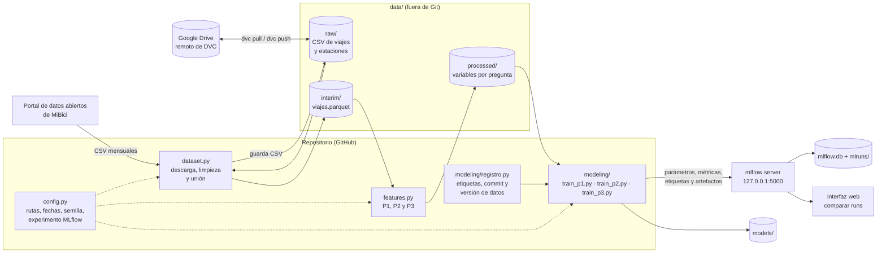

# TC5061-Proyecto-Equipo43 (MiBici MLOps)

<a target="_blank" href="https://cookiecutter-data-science.drivendata.org/">
    
</a>

Proyecto del equipo 43 (MLOps, TC5061.10). Usa los datos abiertos de MiBici, el sistema de
bicicletas públicas de Guadalajara, para responder tres preguntas de negocio con un pipeline
reproducible: ingesta, variables, entrenamiento y registro de experimentos en MLflow.

| # | Pregunta | Quién la usa | Tarea |
|---|---|---|---|
| P1 | ¿Cuántos viajes iniciarán en cada estación el día siguiente? | Operación: repartir bicicletas y personal por zona y día | Regresión |
| P2 | ¿Una estación estará en riesgo de quedarse sin bicicletas o sin anclajes? | Rebalanceo: a qué estaciones ir y si llevar o retirar bicicletas | Clasificación (3 clases) |
| P3 | ¿Qué grupos de estaciones comparten patrones de uso y dónde están? | Planeación urbana: dónde y de qué tipo abrir estaciones | Clustering |

El planteamiento completo está en el ML Canvas
([references/MLCanvas_MiBici.pdf](references/MLCanvas_MiBici.pdf)).

## Arquitectura



- **Datos:** los CSV crudos se versionan con DVC en el Drive del equipo; `dataset.py` también
  puede descargarlos del portal. Nada de `data/`, `models/`, `mlflow.db` ni `mlruns/` se sube a Git.
- **Configuración única:** `config.py` define las rutas, el periodo (`FECHA_INICIO`, `FECHA_FIN`),
  la partición temporal, la semilla (`SEMILLA`) y el experimento de MLflow (`mibici-equipo43`).
- **Experimentos:** cada `train_*.py` registra sus runs en el mismo experimento con la etiqueta
  `question` (P1, P2 o P3), el commit de Git y la versión de los datos. Las corridas se lanzan
  con `mlflow run` (ver [MLflow Project](#mlflow-project)).

## Datos

Los datos crudos son los [datos abiertos de MiBici](https://mibici.net/es/datos-abiertos/) (viajes mensuales 2014-12 a 2026-09 y catálogo de estaciones). No se suben a GitHub: se versionan con DVC en el Google Drive del equipo. Si no tienes acceso a ese Drive, puedes descargarlos directamente de la página oficial.

Detalles de las fuentes, cómo obtener los datos y problemas conocidos en [references/fuentes_datos.md](references/fuentes_datos.md).

Las decisiones técnicas y de análisis del proyecto (por ejemplo, por qué los datos procesados se guardan en Parquet) están en [references/decisiones.md](references/decisiones.md).

## Cómo empezar

Requiere Python 3.13. Para bajar los datos con DVC hace falta acceso a la carpeta de Google
Drive del equipo: pídele a un integrante que comparta la carpeta con tu cuenta de Google y que te
agregue como *test user* de la app OAuth en Google Cloud; sin esto, `dvc pull` muestra "access
blocked". Sin ese acceso, ver la nota debajo del bloque de comandos.

```powershell
git clone https://github.com/robertonali/TC5061-Proyecto-Equipo43.git
cd TC5061-Proyecto-Equipo43
python -m venv .venv
.venv\Scripts\activate
python -m pip install -r requirements.txt
pip install -U pyopenssl
dvc remote modify --local drive gdrive_client_secret <secreto>
dvc pull
python -m mibici_mlops.dataset
```

- **`pip install -U pyopenssl`**: pip instala un `pyOpenSSL` viejo que hace fallar a DVC con
  `module 'lib' has no attribute 'GEN_EMAIL'`. La advertencia de `pydrive2` sobre la versión se
  puede ignorar.
- **`<secreto>`**: el secreto del cliente OAuth de Google. Se comparte por un canal privado y se
  guarda en `.dvc/config.local`, que no se sube a Git. **Nunca lo pongas en `.dvc/config`.**
- **`dvc pull`**: la primera vez abre el navegador para autorizar tu cuenta de Google.
- **`python -m mibici_mlops.dataset`**: une y limpia los 142 CSV de `data/raw/viajes/` en
  `data/interim/viajes.parquet` (~39 millones de viajes; tarda entre 5 y 10 minutos). Qué
  corrige y por qué está en [references/fuentes_datos.md](references/fuentes_datos.md).

**Sin acceso al Google Drive**, omite las líneas de `pyopenssl`, `dvc remote` y `dvc pull`:
`python -m mibici_mlops.dataset` descarga de la página de MiBici los CSV que falten en
`data/raw/` (hasta `FECHA_FIN` de `config.py`, ~2.9 GB) y abril y mayo de 2023 de Internet
Archive. Si ya hiciste `dvc pull` no descarga nada; para no intentarlo, usa `--sin-descargar`.
Los archivos descargados pueden no ser idénticos a la versión de DVC si MiBici los actualiza.

### Verificar que todo quedó bien

| Después de | Revisa | Resultado esperado |
|---|---|---|
| `dvc pull` | `dvc status` | `Data and pipelines are up to date.` |
| `python -m mibici_mlops.dataset` | Las últimas líneas del log | `datos_abiertos_2026_09.csv: 758 filas duplicadas eliminadas` y `39,078,082 viajes guardados` |
| `python -m mibici_mlops.dataset` con datos descargados de la página (sin `dvc pull`) | Las últimas líneas del log | `39,078,226 viajes guardados` al 2026-10-18: MiBici corrigió algunos CSV después de que se registró la versión de DVC |
| Todo lo anterior | Correr `notebooks/1.0-rc-periodo-de-datos.ipynb` con el intérprete de `.venv` | La sección 6 muestra 0 filas con `viaje_id` repetido |

Si un resultado no coincide, avisa al equipo con el mensaje de error antes de seguir.

Al clonar, `data/` solo trae `.gitignore` y `raw.dvc`: `dvc pull` crea `data/raw/`,
`dataset.py` crea `data/interim/` y `features.py` crea `data/processed/` (ver la sección de P2).

### Versionar cambios en los datos

```powershell
dvc add data/raw
git add data/raw.dvc
git commit -m "Actualizar datos"
dvc push        # si falla con WinError 10054: dvc push -j 2
git push
```

## MLflow: servidor de tracking local

Los scripts `train_*.py` mandan sus runs a un servidor de MLflow que corre en tu computadora. El
servidor guarda parámetros, métricas, etiquetas y modelos registrados en `mlflow.db` (SQLite), el
almacenamiento con base de datos que requiere el Model Registry, y los artefactos en `mlruns/`.
Ninguno de los dos se sube a Git: cada integrante tiene su propio historial.

Antes de entrenar, levanta el servidor en una terminal aparte, desde la raíz del proyecto y con el
entorno virtual activado, y déjalo corriendo:

```powershell
mlflow server --backend-store-uri sqlite:///mlflow.db --artifacts-destination mlruns --port 5000 --workers 1
```

Los runs se ven en http://127.0.0.1:5000. Para detener el servidor, `Ctrl+C` en esa terminal.

- Los scripts se conectan a `http://127.0.0.1:5000` (`MLFLOW_TRACKING_URI` en `config.py`). Para
  usar otro servidor, define `MLFLOW_TRACKING_URI` en un archivo `.env` en la raíz del proyecto.
- `--workers 1` levanta un solo proceso. Con los 4 que usa por defecto, en Windows algunos fallan
  con `WinError 10022` porque no pueden compartir el puerto.
- Si el servidor no está corriendo, `train_p1` y `train_p2` fallan de inmediato con un mensaje
  que indica el comando para levantarlo.

## MLflow Project

`MLproject`, en la raíz, declara el entorno (`python_env.yaml`: Python 3.13 con las versiones
fijas de `requirements.txt`) y tres puntos de entrada. Las rutas, fechas, semillas e
hiperparámetros por defecto salen de `config.py`; con `-P` solo se pasa lo que cambia.

| Punto de entrada | Qué corre | Parámetros |
|---|---|---|
| `ingest` | `dataset.py`: descarga los CSV que falten, los une en `data/interim/viajes.parquet` y escribe el manifiesto de los datos (`data/interim/manifiesto.json`) | `descarga`: `descargar` (por defecto) o `sin-descargar` |
| `features` | `features.py`: variables y etiqueta de una pregunta en `data/processed/` | `question`: `p1`, `p2` o `p3` |
| `train` | `modeling/train.py`, que llama al entrenamiento de la pregunta | `question`, `model` y los hiperparámetros del modelo (`-P nombre=valor`) |

Desde un clon limpio, sigue [Cómo empezar](#cómo-empezar) hasta instalar `requirements.txt` (y
`dvc pull` si tienes acceso al Drive), levanta el
[servidor de MLflow](#mlflow-servidor-de-tracking-local) y, en otra terminal con el `.venv`
activado y desde la raíz del proyecto:

```powershell
$env:MLFLOW_TRACKING_URI = "http://127.0.0.1:5000"
mlflow run . -e ingest --env-manager local --experiment-name mibici-equipo43
```

Después siguen los comandos de cada pregunta (ver
[P2](#p2-riesgo-de-que-una-estación-se-vacíe-o-se-llene)). Cada `mlflow run`
crea un run en el experimento `mibici-equipo43` e imprime su id al terminar
(`=== Run (ID '...') succeeded ===`).

- **`MLFLOW_TRACKING_URI`:** `mlflow run` crea el run antes de llamar al script. Sin la variable,
  MLflow lo escribe directo en `mlflow.db`, sin pasar por el servidor.
- **`--experiment-name mibici-equipo43`:** sin él, el run queda en el experimento `Default` y el
  script falla con un mensaje que lo indica.
- **`--env-manager local`:** usa el `.venv` activado. El entorno está declarado en
  `python_env.yaml`, pero con `virtualenv` o `uv` MLflow instala `requirements.txt` desde una
  carpeta temporal con enlaces al proyecto. En Windows, sin permisos de administrador, copia el
  proyecto completo (con los 2.9 GB de `data/raw`), y `-e .` deja el paquete apuntando a esa
  carpeta, que se borra al terminar (decisión 10 de P2).
- **Hiperparámetros:** se pasan con `-P` aunque no estén declarados en `MLproject`; MLflow los
  agrega al comando como `--nombre valor`, y los que no se pasan toman su valor de `config.py`.
  Así `MLproject` no repite los valores por defecto.
- **Opcional:** `$env:LOGNAME = "equipo43"` antes de `mlflow run` para que MLflow no guarde tu
  usuario de Windows en el campo interno de usuario de cada run.

## Model Registry

El modelo elegido de cada pregunta se registra en el Model Registry del servidor, con nombre
`mibici-equipo43-<pregunta>-<tema>`. El ciclo de vida se gestiona con **aliases**:

| Alias | Significado |
|---|---|
| `champion` | La versión en producción: la que cargan las siguientes etapas del proyecto |
| `challenger` | La siguiente mejor, lista para reemplazar a `champion` |

**Por qué aliases y no etapas:** las etapas (`Staging`, `Production`) están obsoletas desde
MLflow 2.9. Un alias es un nombre que apunta a una versión: promover un modelo, o volver al
anterior si falla, es mover el alias, sin crear versiones ni cambiar el código que carga el
modelo. Cada versión guarda su linaje como etiquetas: experimento, run de origen, commit y versión
de los datos.

Con `MLFLOW_TRACKING_URI` apuntando al servidor:

```python
import mlflow

modelo = mlflow.pyfunc.load_model("models:/mibici-equipo43-p2-riesgo@champion")
```

| Pregunta | Modelo registrado | `champion` | `challenger` |
|---|---|---|---|
| P2 | `mibici-equipo43-p2-riesgo` | Versión 1: `HistGradientBoostingClassifier` con pesos de clase | Versión 2: regresión logística |

## P1: demanda de viajes por estación y día

**Pregunta:** ¿cuántos viajes iniciarán en cada estación durante el día siguiente? La usa
operación para repartir bicicletas y personal por zona y por día.

Las decisiones y su justificación están en
[references/decisiones_p1.md](references/decisiones_p1.md).

| Aspecto | Decisión |
|---|---|
| Tarea | Regresión: viajes que inician en la estación durante el día |
| Granularidad | Una fila por estación y día; los días sin viajes cuentan como 0 |
| Horizonte | Cada día a las 23:59 se predice el día siguiente |
| Variables | Historial que termina el día anterior (`lag_7d`, `media_7d`), calendario y datos de la estación |
| Modelos | Baseline: mismo día de la semana pasada (`lag_7d`). Candidato: `HistGradientBoostingRegressor` |
| Métricas | MAE y RMSE en viajes por estación-día (validación y prueba) |

### Cómo correrlo

Después de `python -m mibici_mlops.dataset`:

```powershell
python -m mibici_mlops.features p1                  # variables por estación y día
python -m mibici_mlops.modeling.train_p1            # baseline y gradient boosting en MLflow
pytest tests/test_features_p1.py                    # verifica que no haya fuga de datos
```

**Datos y partición temporal** (marzo de 2022 a septiembre de 2026, con 434,345 filas estación-día para entrenamiento, 66,890 para validación y 75,913 para prueba). Se usa la partición común de `config.py`, igual que P2 y P3:

| Conjunto | Periodo |
|---|---|
| Entrenamiento | hasta 2025-09-30 |
| Validación | 2025-10-01 a 2026-03-31 |
| Prueba | 2026-04-01 a 2026-09-30 |

**Resultados** (MAE y RMSE en viajes por estación y día; menor es mejor):

| Modelo | val_mae | val_rmse | test_mae | test_rmse |
|---|---|---|---|---|
| Baseline: mismo día de la semana pasada | 7.78 | 14.12 | 7.94 | 15.41 |
| Gradient boosting (`HistGradientBoostingRegressor`) | 5.72 | 10.37 | 5.99 | 11.52 |
| Mejora frente al baseline | 26 % | 27 % | 25 % | 25 % |

Configuración elegida con validación: pérdida de Poisson, `learning_rate` 0.1, `max_iter` 300 y `max_leaf_nodes` 63 (semilla 43). Los runs están en MLflow como `p1-baseline-semana-previa` y `p1-gradient-boosting`, y las gráficas en `reports/figures/p1_*`.

**Interpretación**

- El gradient boosting supera al baseline en las cuatro métricas, con una mejora de alrededor de una cuarta parte del error. Se cumple el criterio de despliegue de la propuesta (menor MAE y RMSE que el baseline en prueba).
- Validación y prueba dan errores parecidos (el de prueba es un poco mayor, 5.99 contra 5.72), por lo que no hay señal fuerte de sobreajuste al periodo de validación. La prueba incluye septiembre de 2026, el mes con más uso de la serie.
- El modelo gana todos los días de la semana. Su error es estable (entre 5.5 y 6.2 viajes), mientras que el del baseline varía más y es peor entre semana, sobre todo miércoles y viernes (8.6 y 9.0). El domingo es el día más fácil para ambos.
- El RMSE es casi el doble del MAE, así que hay estaciones-día con errores grandes. El análisis por nivel de uso (`p1_error_por_nivel_uso.csv`) lo confirma: en las estaciones de uso alto (63 viajes al día en promedio) el MAE es de 11.0 viajes, contra 2.9 en las de uso bajo. En proporción a su demanda, el error es menor en las de uso alto (17 % contra 28 %).

Crea dos runs en el experimento `mibici-equipo43`: `p1-baseline-semana-previa` y
`p1-gradient-boosting`. Las gráficas del análisis de error están en `reports/figures/p1_*`.

## P2: riesgo de que una estación se vacíe o se llene

**Pregunta:** ¿una estación estará en riesgo de quedarse sin bicicletas o sin anclajes en un
periodo futuro? La usa el equipo de rebalanceo para decidir a qué estaciones ir y si debe llevar o
retirar bicicletas.

Las decisiones y su justificación están en
[references/decisiones_p2.md](references/decisiones_p2.md), y el análisis que las respalda en
`notebooks/2.0-rc-p2-tamano-ventana.ipynb` (ventanas: secciones 1 a 10; hora de reinicio: 11;
etiqueta: 12; partición: 13).

| Aspecto | Decisión |
|---|---|
| Tarea | Clasificación en 3 clases: sin riesgo, se vacía, se llena |
| Granularidad | Estación y ventana de 2 horas (00:00, 02:00, …, 22:00) |
| Horizonte | Cada día a las 4:00 se predicen las 12 ventanas del día |
| Etiqueta | Inventario simulado: cada estación empieza el día (4:00) al 50% de su capacidad y se le suman las llegadas y restan las salidas. "Se vacía" si llega a 0 o menos; "se llena" si llega a la capacidad |
| Datos | Viajes del 2022-03-01 al 2026-09-30 y capacidad de cada estación. No usa datos de los usuarios (id, género ni año de nacimiento) |
| Partición | Por fechas: entrenamiento 2022-03 a 2025-09, validación 2025-10 a 2026-03 y prueba 2026-04 a 2026-09 |
| Métricas | Recall, precisión y PR-AUC de cada clase de riesgo, en validación y prueba. El modelo se elige con el promedio de la PR-AUC de validación de las dos clases de riesgo |
| Modelo en producción | `HistGradientBoostingClassifier` con pesos de clase: `models:/mibici-equipo43-p2-riesgo@champion` |

Las decisiones de la entrega 2 (candidatos, búsqueda, modelo elegido y registro en MLflow) son las
8, 9 y 10 de [references/decisiones_p2.md](references/decisiones_p2.md).

### Cómo correrlo

Con el [servidor de MLflow](#mlflow-servidor-de-tracking-local) corriendo, después de la ingesta
(ver [MLflow Project](#mlflow-project)) y con todo en commit, porque cada run registra el commit y
si había cambios sin commit:

```powershell
# Etiqueta y variables
mlflow run . -e features --env-manager local --experiment-name mibici-equipo43 -P question=p2
# Baselines
mlflow run . -e train --env-manager local --experiment-name mibici-equipo43 -P question=p2 -P model=mayoritaria
mlflow run . -e train --env-manager local --experiment-name mibici-equipo43 -P question=p2 -P model=frecuencia
# Candidatos
mlflow run . -e train --env-manager local --experiment-name mibici-equipo43 -P question=p2 -P model=logistica
mlflow run . -e train --env-manager local --experiment-name mibici-equipo43 -P question=p2 -P model=hgb
mlflow run . -e train --env-manager local --experiment-name mibici-equipo43 -P question=p2 -P model=hgb -P class_weight=none
# Búsqueda de hiperparámetros (nested runs) y su mejor combinación, que es el modelo elegido
mlflow run . -e train --env-manager local --experiment-name mibici-equipo43 -P question=p2 -P model=busqueda-hgb
mlflow run . -e train --env-manager local --experiment-name mibici-equipo43 -P question=p2 -P model=hgb -P learning_rate=0.05
# Model Registry: el run_id del modelo elegido y el de la logística (los imprime mlflow run)
python -m mibici_mlops.modeling.registrar_p2 --champion <run_id> --challenger <run_id>
```

| Paso | Tiempo | Resultado esperado |
|---|---|---|
| `features` | ~35 s, ~3.6 GB de RAM | `6,979,284 ventanas de 471 estaciones` y clases `sin_riesgo: 81.39`, `se_vacia: 9.77`, `se_llena: 8.83` |
| Cada `train` | De 1 a 2.5 min | Un run con el nombre de la tabla de resultados |
| `busqueda-hgb` | ~10 min | El run padre `p2-busqueda-hgb-balanceado-arboles300` con 6 runs hijos; sus parámetros `mejor_learning_rate` y `mejor_max_leaf_nodes` valen `0.05` y `31` |
| `registrar_p2` | Segundos | `models:/mibici-equipo43-p2-riesgo@champion (versión N) se carga y predice` |

- **Hiperparámetros** (por defecto, los de `P2_HIPERPARAMETROS` en `config.py`): `logistica`
  acepta `c`, `max_iter` y `class_weight` (`balanced` o `none`); `hgb`, `learning_rate`,
  `max_iter` (número de árboles), `max_leaf_nodes` y `class_weight`. `busqueda-hgb` recorre la
  rejilla `P2_BUSQUEDA_HGB`.
- **`registrar_p2` sin opciones** elige los dos candidatos con mayor PR-AUC de validación, que no
  son los elegidos (ver abajo y la decisión 9).
- **Sin `mlflow run`:** `python -m mibici_mlops.modeling.train_p2 --modelo hgb --learning-rate 0.05`
  hace lo mismo que el `train` correspondiente.

### Resultados

PR-AUC promedio de "se vacía" y "se llena" en validación y prueba, y recall y precisión de prueba
("se vacía" / "se llena"). Todos los runs se lanzaron con `mlflow run` desde el commit `b6edd95`.

| Run | `stage_of_work` | Validación | Prueba | Recall | Precisión |
|---|---|---|---|---|---|
| `p2-baseline-clase-mayoritaria` | baseline | 0.080 | 0.064 | 0 / 0 | 0 / 0 |
| `p2-baseline-frecuencia-4-semanas` | baseline | 0.495 | 0.453 | 0.47 / 0.62 | 0.46 / 0.59 |
| `p2-logistica-balanceado-c1.0` | candidate | 0.555 | 0.505 | 0.67 / 0.77 | 0.32 / 0.43 |
| `p2-hgb-balanceado-lr0.1-hojas31-arboles300` | candidate | 0.570 | 0.521 | 0.71 / 0.79 | 0.30 / 0.42 |
| `p2-hgb-sin-pesos-lr0.1-hojas31-arboles300` | candidate | 0.573 | 0.523 | 0.26 / 0.45 | 0.62 / 0.73 |
| `p2-busqueda-hgb-balanceado-arboles300` (6 hijos) | search | 0.569 a 0.571 | — | — | — |
| **`p2-hgb-balanceado-lr0.05-hojas31-arboles300`** | candidate | **0.571** | **0.522** | **0.71 / 0.79** | 0.30 / 0.42 |

- **Clase mayoritaria:** predice siempre "sin riesgo". Acierta en el 87% de las ventanas de prueba,
  pero no detecta ningún riesgo; por eso la exactitud no sirve como métrica. Su PR-AUC es la del
  azar: la proporción de cada clase.
- **Frecuencia de las últimas 4 semanas** (misma estación, mismo día de la semana y misma ventana):
  detecta casi la mitad de las ventanas "se vacía" y el 62% de las "se llena", con una PR-AUC
  entre 6.5 y 7.5 veces la del azar. Es la referencia que deben superar los candidatos; sus cifras
  de prueba son las mismas de la entrega 1.
- **Modelo elegido** (decisión 9): `HistGradientBoostingClassifier` con pesos de clase y
  `learning_rate` 0.05, el mejor de la búsqueda.
  - Supera al baseline en prueba: PR-AUC promedio de 0.522 contra 0.453 (+15%), y detecta el 71%
    de las ventanas que se vacían (47% el baseline).
  - HGB sin pesos tiene 0.002 más de PR-AUC, pero su clase predicha solo detecta el 26% de las
    ventanas que se vacían, y el ML Canvas prioriza el recall de las clases de riesgo.
  - A cambio da más falsas alarmas (precisión de 0.30 en "se vacía"), por lo que la lista diaria
    se ordena por probabilidad.
  - Varía de un mes a otro lo mismo que el baseline; entrena en 81 s y la predicción de un día
    tarda menos de un segundo.
  - `challenger`: la regresión logística, de otra familia, 20 veces más rápida al predecir e
    interpretable.

**Artefactos de cada run** (decisión 10): `plots/` (curvas precisión-recall y matrices de
confusión de validación y prueba, PR-AUC por mes), `data/manifiesto.json`, `config/` (la
configuración del run, `MLproject`, `python_env.yaml`, `requirements.txt` y `config.py`) y, en los
candidatos, el modelo con su firma y un ejemplo de entrada. Además, `log_input` de los conjuntos de
entrenamiento, validación y prueba.

**Capturas de MLflow** (entrega 2):

| Captura | Qué muestra |
|---|---|
| [Nested runs](reports/figures/mlflow2_p2_1_nested_runs.png) | Los runs de P2, con la búsqueda y sus 6 runs hijos |
| [Comparación](reports/figures/mlflow2_p2_2_comparacion.png) | Los 2 baselines y los 4 candidatos con sus métricas de validación y prueba |
| [Artefactos](reports/figures/mlflow2_p2_3_artefactos.png) | `plots/`, `data/` y `config/` del champion |
| [Modelo y firma](reports/figures/mlflow2_p2_4_modelo_firma.png) | El modelo que guardó el champion, con su firma |
| [Model Registry](reports/figures/mlflow2_p2_5_registry.png) | `mibici-equipo43-p2-riesgo` con los aliases `champion` y `challenger` |
| [Linaje](reports/figures/mlflow2_p2_6_linaje.png) | La versión 1 (`champion`) con su run de origen, commit y versiones de los datos |

Las de la entrega 1 están en `reports/figures/mlflow_p2_*.png`.

## P3: grupos de estaciones con patrones de uso parecidos

**Pregunta:** ¿qué grupos de estaciones comparten patrones de uso y dónde se ubican en la
ciudad? La usa planeación urbana para decidir dónde y de qué tipo abrir estaciones nuevas, y para
planear por tipo de estación en lugar de estación por estación.

Las decisiones y su justificación están en
[references/decisiones_p3.md](references/decisiones_p3.md), y la exploración en
`notebooks/1.0-im-initial-eda.ipynb`.

| Aspecto | Decisión |
|---|---|
| Tarea | Clustering de estaciones |
| Granularidad | Una fila por estación con su perfil semanal: fracción de sus salidas y de sus llegadas en cada día de la semana y franja del día (madrugada, mañana, tarde, noche): 56 variables |
| Horizonte | Grupos aprendidos con entrenamiento; se mide si se mantienen en los 6 meses de prueba |
| Datos | Viajes del 2022-03-01 al 2026-09-30 y ubicación de cada estación. No usa datos de los usuarios |
| Partición | Mismas fechas que P2: perfil de entrenamiento 2022-03 a 2025-09 y de prueba 2026-04 a 2026-09 |
| Métricas | Silhouette, Davies-Bouldin y Calinski-Harabasz sobre el perfil de uso (`train_*` y `test_*`), y estabilidad entre periodos (`test_ari_estabilidad`) |

### Cómo correrlo

Después de `python -m mibici_mlops.dataset` y con el [servidor de MLflow](#mlflow-servidor-de-tracking-local) corriendo:

```powershell
python -m mibici_mlops.features p3                  # perfil de cada estación (~5 s, ~3 GB de RAM)
python -m mibici_mlops.modeling.train_p3            # baseline y KMeans registrados en MLflow (~30 s)
```

| Comando | Resultado esperado |
|---|---|
| `features p3` | `entrenamiento: 371 estaciones con perfil` y `prueba: 429 estaciones con perfil` |
| `train_p3` | Dos runs en el experimento `mibici-equipo43`: `p3-baseline-zonas-geograficas-k3` y `p3-kmeans-perfil-uso-k3` |

Cada run guarda como artefactos el mapa de los grupos (`mapa_grupos.png`), su perfil de uso
(`perfil_grupos.png`) y el grupo de cada estación (`estaciones_grupos.json`); el de KMeans,
además, la silhouette según el número de grupos.

### Resultados

| Métrica | Zonas geográficas (baseline) | KMeans sobre perfil de uso |
|---|---|---|
| Silhouette entrenamiento | 0.063 | **0.303** |
| Silhouette prueba | 0.023 | **0.246** |
| Davies-Bouldin entrenamiento (menor es mejor) | 4.059 | **1.128** |
| Davies-Bouldin prueba | 3.721 | **1.278** |
| Calinski-Harabasz entrenamiento | 36.2 | **153.1** |
| Estabilidad (ARI) | 1 (por construcción) | 0.714 |

- **Agrupar por uso da grupos mucho más coherentes que agrupar por zona**: la silhouette es
  casi 5 veces la del baseline, y la ventaja se mantiene en prueba.
- **3 grupos** es el número con mayor silhouette entre 2 y 8 (0.303; con 2 es 0.277 y con 4,
  0.209):
  - **Grupo 1, destinos de trabajo y estudio (163 estaciones):** llegadas en la mañana y salidas
    en la tarde entre semana. 104 de ellas están al poniente (longitud menor a -103.37).
  - **Grupo 2, origen residencial (185):** al revés, salidas en la mañana y llegadas en la tarde
    y la noche. 155 están en el centro y el oriente.
  - **Grupo 3, recreativo (23):** el 21% de sus salidas son en domingo (contra 8–9% de los otros
    grupos), casi la mitad el domingo en la mañana. Forman una línea de oriente a poniente que
    coincide con la Vía RecreActiva.
- **Los grupos se mantienen:** el ARI de 0.71 indica que la mayoría de las estaciones conserva su
  grupo de un periodo a otro.
- **Estaciones nuevas:** 113 estaciones del catálogo no tienen viajes antes de octubre de 2025.
  64 de ellas ya tienen perfil en prueba y el modelo les asigna un grupo (33 al 2, 20 al 1 y 11
  al 3): es lo que planeación urbana necesita para saber qué tipo de estaciones abrió.

Las capturas de MLflow están en `reports/figures/mlflow_p3_*.png`: lista de runs, detalle del
run de KMeans (métricas, parámetros y etiquetas), el mapa de grupos como artefacto y la
comparación contra el baseline.

## Flujo de trabajo en Git

Seguimos **GitHub Flow**:

1. `master` siempre funciona; nadie hace commit directo a `master`.
2. Cada cambio va en su propia rama, con un prefijo según el tipo: `feat/`, `fix/`, `docs/`,
   `chore/` (por ejemplo, `feat/p2-riesgo-estaciones`).
3. Los commits siguen [Conventional Commits](https://www.conventionalcommits.org/es/):
   `tipo(alcance): descripción`, por ejemplo `feat(p3): registrar baseline geográfico y KMeans en MLflow`.
4. La rama se integra a `master` con un **Pull Request** que revisa y aprueba otro integrante.
5. Antes de integrar, la rama se actualiza con `master` y se resuelven los conflictos en la rama,
   no en `master`.

```powershell
git switch master
git pull
git switch -c feat/mi-cambio
# ... cambios ...
git add <archivos>
git commit -m "feat(p1): descripción corta"
git push -u origin feat/mi-cambio
gh pr create --base master --fill
```

## Integrantes

| Integrante | GitHub | Contribución principal |
|---|---|---|
| Roberto | [@robertonali](https://github.com/robertonali) | Ingesta y versionado de datos (DVC), configuración del proyecto y P2 |
| Manuel Medina | [@manuelMedinaMna](https://github.com/manuelMedinaMna) | ML Canvas y P1 |
| Iñaki Medina | [@imedina-tec](https://github.com/imedina-tec) | Exploración y clustering de estaciones (P3) |
| Fernando Mejía | [@ego-mejia](https://github.com/ego-mejia) | P3 en el pipeline (features, MLflow), descarga automática de datos, README y arquitectura |

## Project Organization

```
├── LICENSE            <- MIT (aplica al código; los datos son de MiBici)
├── MLproject          <- MLflow Project: entorno y puntos de entrada ingest, features y train
├── python_env.yaml    <- Entorno del MLflow Project (Python 3.13 y requirements.txt)
├── Makefile           <- Makefile with convenience commands like `make data` or `make train`
├── README.md          <- The top-level README for developers using this project.
├── data
│   ├── external       <- Data from third party sources.
│   ├── interim        <- Intermediate data that has been transformed.
│   ├── processed      <- The final, canonical data sets for modeling.
│   └── raw            <- The original, immutable data dump.
│
├── docs               <- A default mkdocs project; see www.mkdocs.org for details
│
├── models             <- Trained and serialized models, model predictions, or model summaries
│
├── notebooks          <- Jupyter notebooks. Naming convention is a number (for ordering),
│                         the creator's initials, and a short `-` delimited description, e.g.
│                         `1.0-jqp-initial-data-exploration`.
│
├── pyproject.toml     <- Project configuration file with package metadata for 
│                         mibici_mlops and configuration for tools like black
│
├── references         <- Data dictionaries, manuals, and all other explanatory materials.
│
├── reports            <- Generated analysis as HTML, PDF, LaTeX, etc.
│   └── figures        <- Generated graphics and figures to be used in reporting
│
├── tests              <- Pruebas con pytest (por ejemplo, que P1 no tenga fuga de datos)
│
├── requirements.txt   <- Dependencias directas del proyecto (agregar a mano; no usar
│                         `pip freeze`, ver sección "Cómo empezar")
│
└── mibici_mlops   <- Source code for use in this project.
    │
    ├── __init__.py             <- Makes mibici_mlops a Python module
    │
    ├── config.py               <- Store useful variables and configuration
    │
    ├── dataset.py              <- Scripts to download or generate data
    │
    ├── features.py             <- Variables de P1, P2 y P3 (`python -m mibici_mlops.features p1|p2|p3`)
    │
    ├── modeling                
    │   ├── __init__.py 
    │   ├── predict.py          <- Code to run model inference with trained models          
    │   ├── registrar_p2.py     <- P2: modelo elegido al Model Registry (champion y challenger)
    │   ├── registro.py         <- Experimento, etiquetas y versión de datos de MLflow (P1, P2, P3)
    │   ├── train.py            <- Punto de entrada train del MLproject: llama al de cada pregunta
    │   ├── train_p1.py         <- P1: baseline y gradient boosting registrados en MLflow
    │   ├── train_p2.py         <- P2: baselines, candidatos y búsqueda registrados en MLflow
    │   └── train_p3.py         <- P3: baseline y KMeans registrados en MLflow
    │
    └── plots.py                <- Code to create visualizations
```

--------

