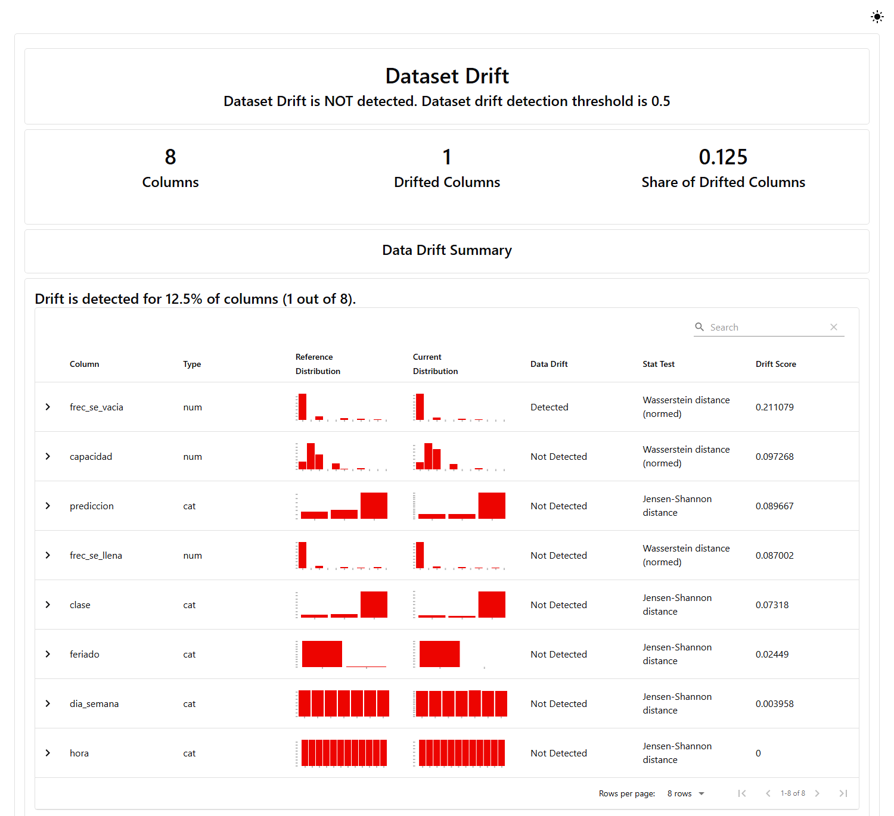
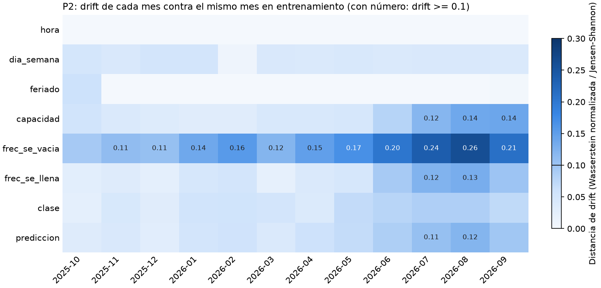
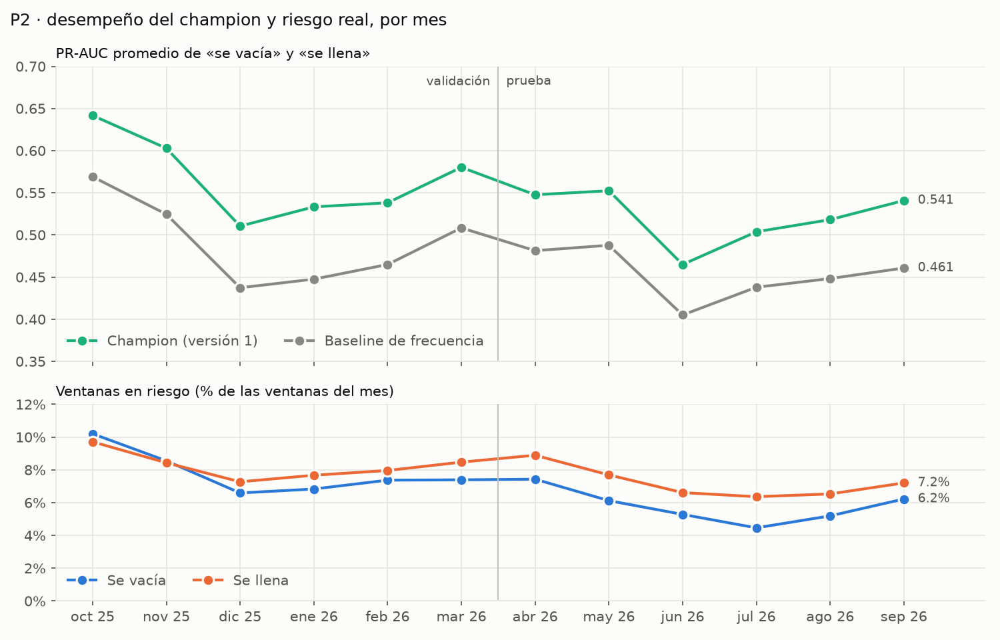

# P2: monitoreo, A/B y recomendación de reentrenamiento (entrega 8)

Modelo: `mibici-equipo43-p2-riesgo`, `champion` = versión 1 (`HistGradientBoostingClassifier` con
pesos de clase). Predice si una estación se vacía, se llena o queda sin riesgo en cada ventana de
2 horas. Reproducir, con el servidor de MLflow activo: `make monitoreo_p2`, `make reentrenar_p2` y
`make ab_p2`. Los periodos y las reglas están en las decisiones 12 y 13 de
[references/decisiones_p2.md](../../references/decisiones_p2.md).

**Resumen**

- De 8 columnas vigiladas, solo `frec_se_vacia` tiene drift (0.11 en validación y 0.21 en
  prueba). El cambio es real y crece: las ventanas que se vacían pasan de 10.8% a 5.7%.
- La PR-AUC promedio del `champion` baja de 0.571 a 0.522, pero conserva su ventaja sobre el
  baseline (+0.076 y +0.069). Lo que sí se pierde es recall de "se vacía": de 0.76 a 0.71.
- La versión reentrenada con seis meses más (versión 3) mejora la PR-AUC promedio en +0.0028, con
  intervalo de confianza de +0.0024 a +0.0032: una mejora real pero menor que el margen de 0.005.
  **La versión 1 sigue como `champion`.**
- Recomendación: no reentrenar hoy; monitorear cada mes y reentrenar cuando haya meses nuevos que
  incluyan a las 100 estaciones que abrieron en 2026.

## 1. Conjuntos de datos

| Conjunto | Periodo | Ventanas | Estaciones | Uso |
|---|---|---|---|---|
| Referencia (`entrenamiento`) | 2022-03-01 a 2025-09-30 | 5,247,312 | 371 | Con él se ajustó el `champion` |
| Actual 1 (`validacion`) | 2025-10-01 a 2026-03-31 | 809,388 | 371 | Primeros seis meses después del corte |
| Actual 2 (`prueba`) | 2026-04-01 a 2026-09-30 | 922,584 | 469 | Los seis meses siguientes: lo más cercano a producción |

Cada fila es una estación y una ventana de 2 horas. Se vigilan 8 columnas: las 6 variables del
modelo (`hora`, `dia_semana`, `feriado`, `capacidad`, `frec_se_vacia`, `frec_se_llena`), la
etiqueta (`clase`) y la clase que predice el `champion` (`prediccion`). Son dos periodos actuales
para ver si el cambio crece. Seis meses contra toda la referencia es una comparación justa porque,
dentro de entrenamiento, de octubre a marzo y de abril a septiembre las clases de riesgo difieren
en menos de medio punto porcentual. La API de la entrega 4 no guarda las peticiones, así que se
usan los datos abiertos.

## 2. Reporte de drift (Evidently)

Reportes completos, con el drift por variable y la calidad de los datos:
[validación](p2_drift_calidad_validacion.html) y [prueba](p2_drift_calidad_prueba.html). Números:
[p2_drift_variables.csv](p2_drift_variables.csv), [p2_drift_por_mes.csv](p2_drift_por_mes.csv) y
[p2_drift_resumen.json](p2_drift_resumen.json). Todo quedó también en el run `p2-monitoreo` de
MLflow.

Método: distancia de Wasserstein normalizada para las variables numéricas y de Jensen-Shannon para
las categóricas. Hay drift si la distancia es >= 0.1, y el conjunto lo tiene si la mitad o más de
las columnas lo tienen.

| Columna | Validación | Prueba |
|---|---|---|
| `frec_se_vacia` | **0.11** | **0.21** |
| `capacidad` | 0.04 | 0.10 |
| `prediccion` (clase que predice el `champion`) | 0.04 | 0.09 |
| `frec_se_llena` | 0.03 | 0.09 |
| `clase` (etiqueta) | 0.04 | 0.07 |
| `feriado` | 0.02 | 0.02 |
| `dia_semana` | 0.00 | 0.00 |
| `hora` | 0.00 | 0.00 |

Resumen del reporte de Evidently de prueba (captura del HTML; la de validación es
[p2_evidently_validacion.png](p2_evidently_validacion.png)):

Cada mes contra el mismo mes de los años de entrenamiento, para quitar la estacionalidad:

Calidad de los datos: sin valores faltantes, sin ventanas duplicadas y sin valores fuera de rango
(frecuencias, horas, capacidad, clases) en los tres conjuntos.

## 3. Interpretación

| | Entrenamiento | Validación | Prueba |
|---|---|---|---|
| Ventanas "se vacía" / "se llena" | 10.8% / 9.2% | 7.8% / 8.3% | 5.7% / 7.2% |
| Columnas con drift (de 8) | | 1 | 1 |
| Estaciones nuevas (y sus ventanas) | | 2 (0.4%) | 100 (12.2%) |
| PR-AUC promedio del `champion` | | 0.571 | 0.522 |
| PR-AUC promedio del baseline de frecuencia | | 0.495 | 0.453 |
| Ventaja del `champion` sobre el baseline | | +0.076 | +0.069 |
| Recall de "se vacía" / "se llena" | | 0.76 / 0.82 | 0.71 / 0.79 |
| Precisión de "se vacía" / "se llena" | | 0.34 / 0.44 | 0.30 / 0.41 |

**Qué cambió en los datos**

- **Solo una variable pasa el umbral, y es de las que más informan al modelo.** `frec_se_vacia`
  es la fracción de las 4 semanas anteriores en que esa estación se vació en esa ventana. Junto
  con `frec_se_llena` es la señal principal: el baseline, que solo usa esas frecuencias, alcanza
  0.495 de los 0.571 de PR-AUC del modelo en validación.
- **El cambio es real y crece; no es estacional.** Contra el mismo mes de entrenamiento,
  `frec_se_vacia` pasa el umbral desde noviembre de 2025 y sube hasta 0.26 en agosto de 2026. Su
  origen es la etiqueta: las ventanas que se vacían pasan de 10.8% a 5.7%. Los datos no dicen por
  qué; P1 también encontró drift en los viajes por estación (decisión 8 de P1), así que cambió el
  uso de la red.
- **El umbral no ve la caída del riesgo en la etiqueta.** `clase` queda en 0.07 aunque "se vacía"
  cayó casi a la mitad: la distancia se mueve poco cuando cambia una clase que es minoría. Contar
  columnas con drift no basta; hay que mirar el desempeño.
- **La red creció.** `capacidad` llega a 0.10 en prueba y pasa el umbral desde julio de 2026.
  Abrieron 100 estaciones, 98 de ellas entre mayo y agosto, y en septiembre ya son el 21% de las
  ventanas.
- **El calendario no cambia** (`hora`, `dia_semana` y `feriado` quedan debajo de 0.03): cada
  estación tiene sus 12 ventanas todos los días.

**Qué implica para el modelo**

1. **La PR-AUC baja, pero el modelo conserva su ventaja.** Baja 0.049 (de 0.571 a 0.522) y el
   baseline baja 0.042: con menos riesgo, anticiparlo es más difícil para cualquier modelo. La
   ventaja del `champion` por mes se mantiene entre +0.060 y +0.086: su mínimo fue en junio de
   2026 y en septiembre volvió a +0.080. No es un modelo que se esté quedando viejo.
2. **Se detectan menos ventanas que se vacían.** El recall de "se vacía" baja de 0.76 a 0.71; por
   mes, de 0.79 en octubre de 2025 a 0.67 en agosto de 2026. El de "se llena" baja de 0.82 a 0.79.
   Al baseline le pasa lo mismo (de 0.52 a 0.47 en "se vacía"): los vaciados que quedan son más
   difíciles de anticipar con la frecuencia de las semanas anteriores. Es la señal que más importa
   al equipo de rebalanceo, que prioriza no dejar estaciones sin bicicletas.
3. **Las alertas son un poco menos certeras.** La precisión de "se vacía" baja de 0.34 a 0.30: de
   cada 10 alertas de vaciado, 7 no se cumplen.
4. **El modelo rinde peor en las estaciones nuevas.** Ahí detecta el 47% de las ventanas que se
   vacían, contra el 72% en las que conoce, y su PR-AUC promedio es 0.33 contra 0.53. Hoy pesan
   poco porque casi no tienen riesgo (1.0% y 1.7% de sus ventanas, contra 6.4% y 7.9%), pero son
   1 de cada 5 estaciones.

**Limitaciones.** El desempeño en entrenamiento no se compara porque el modelo se ajustó con esas
ventanas; la referencia del desempeño es la validación. La etiqueta sale de un inventario simulado
(decisión 4), así que "menos riesgo" es menos riesgo según esa simulación.

## 4. Versión alternativa

Versión 3 de `mibici-equipo43-p2-riesgo`, alias `reentrenado`: el mismo modelo y los mismos
hiperparámetros del `champion` (`learning_rate` 0.05, 31 hojas, 300 árboles, pesos de clase),
ajustado con entrenamiento y validación, del 2022-03-01 al 2026-03-31 (6,056,700 ventanas, 15%
más). Run `p2-hgb-balanceado-lr0.05-hojas31-arboles300-ampliado`. Como solo cambian los datos, el
A/B responde una pregunta: ¿sirve reentrenar con datos más recientes?

## 5. A/B testing

Las dos versiones predicen las mismas 922,584 ventanas de `prueba` (183 días), que ninguna usó
para ajustarse. Es un A/B fuera de línea: la etiqueta no depende de lo que el modelo predijo, así
que las dos se pueden medir sobre los mismos datos.

| Métrica en `prueba` | Versión 1 (`champion`) | Versión 3 (`reentrenado`) | Diferencia |
|---|---|---|---|
| PR-AUC promedio (mayor es mejor) | 0.5220 | 0.5248 | +0.0028 |
| PR-AUC de "se vacía" | 0.4421 | 0.4479 | +0.0058 |
| PR-AUC de "se llena" | 0.6019 | 0.6016 | −0.0003 |
| Recall de "se vacía" / "se llena" | 0.7105 / 0.7871 | 0.7135 / 0.7869 | +0.0030 / −0.0002 |
| Precisión de "se vacía" / "se llena" | 0.3016 / 0.4147 | 0.2995 / 0.4158 | −0.0021 / +0.0011 |

- **Intervalo de confianza de 95% de la diferencia de PR-AUC promedio: +0.0024 a +0.0032.** Se
  calcula con bootstrap por días: la comparación se repite 500 veces, cada vez con 183 días de
  prueba elegidos al azar con repetición. La versión 3 gana en las 500.
- **Por mes**, la versión 3 gana en los 6: +0.0029, +0.0041, +0.0041, +0.0030, +0.0007 y +0.0024,
  de abril a septiembre.

**Decisión: la versión 1 sigue como `champion`.** La regla, fijada en `config.py` antes de correr
el A/B, pide tres cosas: que la PR-AUC promedio mejore al menos 0.005, que el intervalo de
confianza quede arriba de 0 y que el recall de ninguna clase de riesgo baje más de 0.01. La
versión 3 cumple la segunda y la tercera, pero su mejora de +0.0028 no llega al margen. Es una
mejora real, no casualidad, y a la vez demasiado pequeña para justificar el cambio: volver a
exportar el modelo, reconstruir la imagen de la API y repetir las pruebas. El resultado está en
[p2_ab_resultado.json](p2_ab_resultado.json), en el run `p2-ab-test` y como etiquetas de las dos
versiones.

## 6. Recomendación: Continuous Training

**Hoy no conviene cambiar de modelo, pero sí dejar armado el reentrenamiento.**

- **Reentrenar con seis meses más casi no ayuda.** De los 0.049 que bajó la PR-AUC, 0.042 los
  comparte el baseline y 0.007 son ventaja perdida; la versión reentrenada recupera 0.003. El
  recall de "se vacía" tampoco se recupera (0.7105 contra 0.7135).
- **Por qué:** los seis meses que se agregaron se parecen a lo que el modelo ya conocía, las
  mismas 371 estaciones con algo menos de riesgo. Lo nuevo de verdad son las 100 estaciones, que
  abrieron después (mayo a agosto de 2026): ninguna de las dos versiones las vio.
- **El costo de reentrenar no es el cómputo** (3 minutos de entrenamiento y 5 del A/B). Es tener
  meses nuevos que ninguna versión haya visto, para evaluarlas, y volver a desplegar.

Propuesta: correr `make monitoreo_p2` con cada mes nuevo de datos abiertos, y reentrenar y correr
el A/B (`make reentrenar_p2` y `make ab_p2`) cuando pase alguna de estas señales. Son umbrales
propuestos con 12 meses de monitoreo; conviene revisarlos con más periodos.

| Señal de cada mes | Hoy | Reentrenar si |
|---|---|---|
| Ventaja del `champion` sobre el baseline (PR-AUC promedio) | +0.060 a +0.086 | Baja de +0.05 dos meses seguidos |
| Recall de "se vacía" | 0.67 a 0.79 | Baja de 0.65 dos meses seguidos |
| Drift de `prediccion` contra el mismo mes | Hasta 0.12 (julio y agosto de 2026) | Pasa 0.1 tres meses seguidos |

- **Siguiente reentrenamiento recomendado:** cuando se agreguen los datos de octubre a diciembre
  de 2026. Entrenar hasta septiembre de 2026, que ya incluye a las estaciones nuevas, y correr el
  A/B sobre esos meses.
- **Como respaldo, una vez al año** aunque no pase ninguna señal: al ritmo de este A/B (+0.003 por
  semestre), la mejora pasaría el margen en alrededor de un año. Es una extrapolación de un solo
  dato.
- **La versión nueva solo se promueve con la regla del A/B** (`ab_p2 --promover`), nunca de forma
  automática por haberse reentrenado.
- **Reentrenar no recupera el recall.** Con las mismas variables el modelo aprende lo mismo; la
  decisión 9 ya apuntaba a variables nuevas (riesgo del día anterior, demanda pronosticada por P1,
  clima) como la siguiente mejora.
