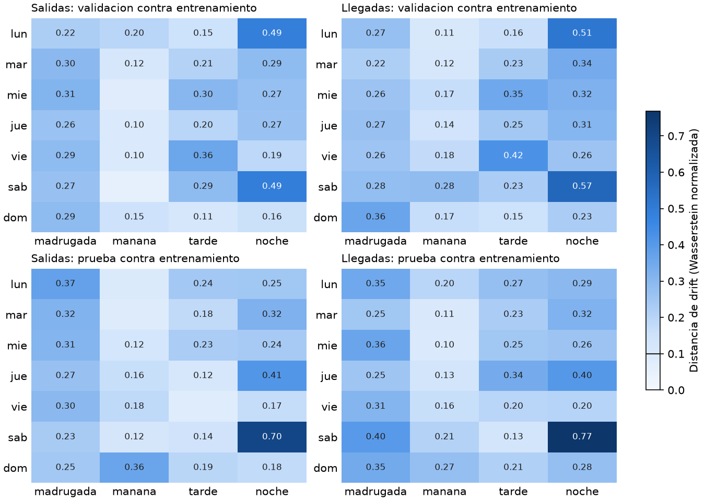
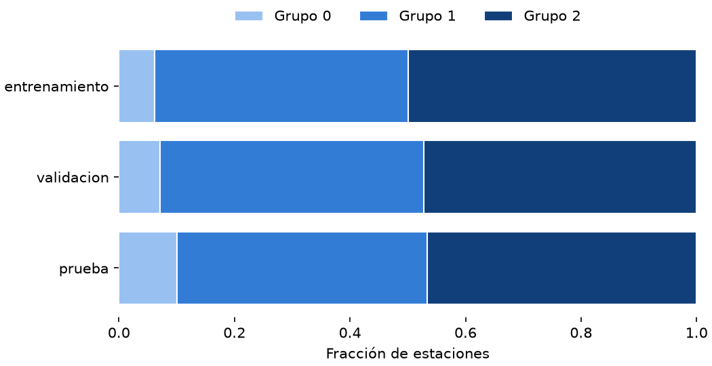

# P3: monitoreo, A/B y recomendación de reentrenamiento (entrega 8)

Modelo: `mibici-equipo43-p3-clusters`, `champion` = versión 1 (`kmeans_k3`, 3 grupos de estaciones
por su perfil semanal de uso). Reproducir: `make monitoreo_p3`, `make reentrenar_p3`, `make ab_p3`.
Los periodos y las reglas de decisión están en la decisión 8 de
[references/decisiones_p3.md](../../references/decisiones_p3.md).

## 1. Conjuntos de datos

| Conjunto | Periodo | Estaciones con perfil | Uso |
|---|---|---|---|
| Referencia (`entrenamiento`) | 2022-03-01 a 2025-09-30 | 371 | Con él se ajustó el `champion` |
| Actual 1 (`validacion`) | 2025-10-01 a 2026-03-31 | 366 | Primeros seis meses después del corte |
| Actual 2 (`prueba`) | 2026-04-01 a 2026-09-30 | 429 | Seis meses siguientes: lo más cercano a producción |

Cada fila es una estación, con 56 variables: la fracción de sus salidas y de sus llegadas en cada
día de la semana y franja del día. Se eligieron dos periodos actuales para ver si el cambio crece.
La API de la semana 8 no registra las peticiones, así que se usan los datos abiertos.

## 2. Reporte de drift (Evidently)

Reportes completos, con el drift por variable y la calidad de los datos:
[validación](p3_drift_calidad_validacion.html) y [prueba](p3_drift_calidad_prueba.html).
Números por variable: [p3_drift_variables.csv](p3_drift_variables.csv) y
[p3_drift_resumen.json](p3_drift_resumen.json). Todo quedó también en el run `p3-monitoreo` de
MLflow.

Método: distancia de Wasserstein normalizada para las 56 variables, Jensen-Shannon para el grupo;
hay drift si la distancia es >= 0.1, y el conjunto lo tiene si la mitad o más de las columnas lo
tienen.

## 3. Interpretación

| | Entrenamiento | Validación | Prueba |
|---|---|---|---|
| Variables con drift (de 57) | | 54 | 53 |
| Distancia de drift promedio | | 0.245 | 0.251 |
| Distancia de drift máxima | | 0.57 | 0.77 |
| Drift del grupo asignado | | 0.020 | 0.051 |
| Estaciones nuevas / que salen | | 2 / 7 | 64 / 6 |
| Silhouette del `champion` | 0.303 | 0.261 | 0.246 |
| Davies-Bouldin del `champion` | 1.128 | 1.249 | 1.281 |

- **El drift es amplio pero moderado.** Casi todas las variables pasan el umbral de 0.1, con una
  distancia típica de 0.25 desviaciones estándar de la referencia. Que 53 de 57 variables lo
  rebasen indica un cambio general en cuándo se usan las estaciones, no un fallo en una variable.
  El umbral de 0.1 es sensible con 56 variables correlacionadas (si crece una franja, las otras
  fracciones bajan), así que conviene mirar la magnitud y no solo el conteo.
- **El mayor cambio es el sábado en la noche.** Salidas (0.70) y llegadas (0.77) en `prueba`,
  contra 0.49 y 0.57 en validación. Le siguen el jueves en la noche (0.41 y 0.40), el lunes en la
  madrugada (0.37) y el domingo en la mañana (0.36). Los datos muestran que cambió la fracción de
  viajes en esas franjas; no dicen por qué.
- **Los grupos casi no se movieron.** El drift del grupo asignado es de 0.02 y 0.05, bajo el
  umbral. El grupo 0, el de más salidas y llegadas en domingo, pasó de 6.2 % de las estaciones a 7.1 % y
  a 10.0 %. Es el único cambio claro en la composición.
- **La separación de los grupos empeora.** El silhouette baja de 0.303 a 0.261 y a 0.246, y
  Davies-Bouldin sube de 1.13 a 1.28. Los grupos describen peor al conjunto de estaciones actual.
- **La red creció.** En `prueba` hay 64 estaciones que no tenían perfil en entrenamiento (17 % de
  las 371 de la referencia). El modelo les asigna grupo aunque no las haya visto.
- **Limitación.** La referencia abarca 3.5 años y cada periodo actual, seis meses (`prueba` es de
  abril a septiembre). Parte del drift puede ser estacional y con estos perfiles no se separa.

**Implicación para el desempeño.** Sin etiquetas no hay una métrica de acierto. Lo que muestran
los datos es que los grupos se siguen asignando de forma estable (drift del grupo bajo) pero se
separan menos entre sí. Es una señal de que el modelo describe cada vez peor las estaciones
nuevas y las que cambiaron su patrón nocturno y de fin de semana, no de que haya dejado de
funcionar.

## 4. Versión alternativa

Versión 3 de `mibici-equipo43-p3-clusters`, alias `reentrenado`: el mismo modelo (`kmeans_k3`) y los
mismos hiperparámetros, ajustado con el perfil de toda la ventana de entrenamiento y validación
(2022-03-01 a 2026-03-31, 373 estaciones). Run `p3-kmeans_k3-ampliado`.

## 5. A/B testing

Las dos versiones asignan grupos a los mismos 429 perfiles de `prueba`, que ninguna usó para
ajustarse.

| Métrica en `prueba` | v1 (`champion`) | v3 (`reentrenado`) |
|---|---|---|
| Silhouette (mayor es mejor) | 0.2458 | 0.2496 |
| Davies-Bouldin (menor es mejor) | 1.2810 | 1.2668 |
| Calinski-Harabasz (mayor es mejor) | 160.6 | 163.7 |
| Estaciones por grupo (0 / 1 / 2) | 43 / 186 / 200 | 40 / 191 / 198 |

ARI entre las asignaciones de las dos versiones: 0.933.

**Decisión: la versión 1 sigue como `champion`.** La regla, fijada antes de correr el A/B, pide
mejorar el silhouette al menos 0.01 sin empeorar Davies-Bouldin. La versión 3 lo mejora 0.004 y
mejora las tres métricas, pero por menos del margen. Además, el 93 % de coincidencia entre las
dos asignaciones indica que son prácticamente el mismo modelo. El resultado está en
[p3_ab_resultado.json](p3_ab_resultado.json), en el run `p3-ab-test` y como etiquetas de la
versión 3.

## 6. Recomendación: Continuous Training

**Hoy no conviene reentrenar.** Incluir seis meses más de datos casi no cambia los grupos
(ARI 0.93) y sube el silhouette 0.004. La caída del silhouette de 0.303 a 0.246 se debe a que el
conjunto actual es menos separable, no a que el modelo esté desactualizado: la versión
reentrenada con esos datos no la recupera.

Propuesta para el Continuous Training: correr `make monitoreo_p3` con cada semestre de datos
nuevos y reentrenar (`make reentrenar_p3` y `make ab_p3`) si pasa alguna de estas condiciones.
Son umbrales propuestos, no medidos, y conviene revisarlos con más periodos:

- el silhouette del `champion` en el periodo actual cae por debajo de 0.20 (hoy 0.246);
- el drift del grupo asignado llega a 0.1 (hoy 0.051);
- la proporción de alguno de los grupos cambia más de 5 puntos porcentuales respecto a
  entrenamiento (hoy, el grupo 0, 3.8 puntos);
- las estaciones sin perfil de entrenamiento superan el 25 % (hoy 17 %).

Con dos o más de ellas, un reentrenamiento tiene más probabilidad de cambiar los grupos de verdad,
y el A/B decide si la nueva versión se promueve.
